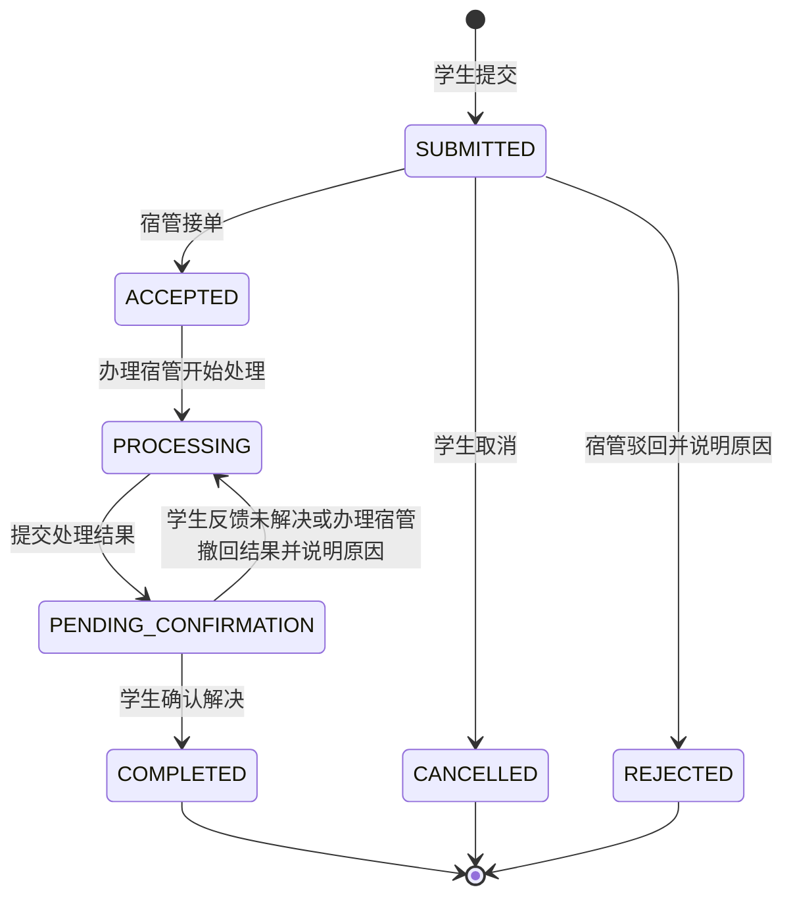

# 学生公寓综合服务管理平台需求与验收

版本：需求基线1.1，2026年11月7日加入用户批准的多宿管动态调度与宿管AI，11月13日同步后续批准的服务闭环。适用范围：单校学生公寓，Java、Vue与原生ArkTS共用业务服务。基础版本证据保留在[07](07-开发与验收.md)与[09](09-动态调度交付与验收.md)，当前实现及联合验收见[16](16-服务闭环与联合验收.md)；以下是验收标准，未验证项不因可构建而视为通过。

目标是形成“入住有档案、来访有记录、卫生有评分、报修有闭环”的服务流程。优先完成题目要求的五类业务和两类角色，AI 作为报修填写助手，不改变业务责任归属。

## 1 角色与业务边界

| 使用者 | 主要端 | 核心工作 | 数据范围 |
| --- | --- | --- | --- |
| 学生 STUDENT | 鸿蒙端 | 提交本人报修、查看本人进度、确认解决或反馈未解决；查看本人入住与入住期间宿舍卫生记录 | 本人资料、本人报修，以及与有效入住期间重叠的本宿舍卫生记录 |
| 宿管 MANAGER | Vue Web、鸿蒙端 | 管理宿舍与学生入住；查询和办理报修；登记访客及离访；录入巡检；查看统计 | 被授权的负责楼栋；查询、统计、附件下载均执行同一范围 |

本期不新增维修人员、教师、院系管理员或系统管理员业务角色。接单、联系实际维修和录入结果均由宿管办理。宿管账号及负责楼栋由初始化数据或部署维护入口配置，不向学生提供注册宿管功能。

### 1.1 权限矩阵

“允许”还需要满足本人或负责楼栋范围；隐藏菜单不能代替服务端授权。

| 功能 | 学生鸿蒙端 | 宿管 Web | 宿管鸿蒙端 |
| --- | --- | --- | --- |
| 登录、退出、查看本人资料 | 允许 | 允许 | 允许 |
| 维护楼栋、宿舍档案与容量 | 不允许 | 允许 | 查询 |
| 维护学生资料、入住、调宿、退宿 | 只读本人入住 | 允许 | 查询本人业务所需的学生与宿舍 |
| 新建报修及上传故障图 | 本人当前入住 | 不代学生新建 | 不代学生新建 |
| 查看工单及时间线 | 本人报修 | 负责楼栋 | 负责楼栋 |
| 接单、处理、提交处理结果、驳回 | 不允许 | 允许 | 允许 |
| 待确认工单确认解决或反馈未解决 | 本人报修 | 只读 | 只读 |
| 待确认阶段带原因撤回处理结果返修 | 不允许 | 仅原办理宿管 | 仅原办理宿管 |
| 取消报修 | 本人待受理工单 | 不允许 | 不允许 |
| 登记访客、记录离访 | 不允许 | 允许 | 允许 |
| 查询访客记录 | 不允许 | 允许 | 允许 |
| 录入、修正卫生巡检评分 | 不允许 | 允许 | 允许 |
| 查看卫生巡检记录 | 本宿舍有效入住期间 | 负责楼栋 | 负责楼栋 |
| 宿舍入住、报修、卫生、访客统计 | 不允许 | 负责楼栋 | 今日工作摘要 |
| AI 故障描述与分类建议 | 允许主动调用 | 查看已采纳的最终工单信息 | 查看已采纳的最终工单信息 |
| 修改结构化可上门偏好 | 本人工单 | 负责楼栋内安排；可确认预约 | 负责楼栋内安排；可确认预约 |
| 查看路线与待安排原因 | 不允许 | 授权范围 | 授权范围 |
| 更新本人接单意愿、位置和可用截止时间 | 不允许 | 仅本人 | 仅本人 |
| 认领、出发、到达、受阻、恢复 | 不允许 | 按任务归属和楼栋校验 | 按任务归属和楼栋校验 |
| 显式交接尚未开始的已接单工单 | 不允许 | 原办理宿管，接收人需有资格 | 原生宿管有入口 |
| 维护楼栋间通行估算 | 不允许 | 同时有双方楼栋权限 | 本轮无入口 |
| AI单单研判、值班简报 | 不允许 | 授权数据，主动同意，只读 | 授权数据，主动同意，只读 |

同一账号即使有多个角色，切换界面也只切换当前操作身份，不增加已有授权范围。本期优先按单角色账号交付；双角色账号属于后续扩展，不作为演示前提。

## 2 范围与优先级

| 优先级 | 内容 | 交付要求 |
| --- | --- | --- |
| P0 题目必需 | 学生、宿舍档案、访客、报修、卫生五类数据；登录授权；图片；记录查询；统计 | 必须完成，AI 不可成为这些功能的依赖 |
| P1 已批准扩展 | 多宿管动态路线、结构化访问安排、学生AI与宿管研判／简报 | 已有正式实现，新增能力按09单独验收；无模型不阻塞人工流程 |
| P2 可选 | 宿舍规章知识问答、其他统计专题摘要、数据导入导出、站内消息、处理时效提醒 | 不纳入 P0 验收和首轮工作量承诺 |
| 本期不做 | 门禁硬件、支付、水电计费、刷脸、自动判定学生行为、维修商结算、多校租户 | 保持题目范围清晰 |

默认一个宿舍只有房间容量与入住名额，无独立床位实体。若学校要求精确到床号，应在编码前补充床位及床位占用设计。默认只维护在校住宿学生，不做完整教务学籍系统。

## 3 功能需求

### 3.1 账号与授权

- **FR-A01** 学生和宿管通过账号密码登录；界面显示当前身份。学生账号与学生档案绑定，学生不可自行修改学号、角色、负责楼栋或入住。
- **FR-A02** 登录失败给出可操作提示；过期登录恢复到登录页，并保留无需敏感信息的返回路径。宿管不因使用移动端而获得更大数据范围。
- **FR-A03** 每次查询、修改、统计和附件访问都校验角色及范围。学生通过猜测工单号、学生编号、图片地址也不能读取他人信息。
- **FR-A04** 禁用账号不能继续使用原会话；账号口令不能明文存储。关键业务操作保留操作人、时间和变更前后业务状态。

### 3.2 宿舍档案与学生入住

- **FR-D01** 宿管维护楼栋名称、楼栋编码、房间号、楼层、容量、房间状态和备注；同楼栋房间号唯一，不能将 `A栋 302` 与 `B栋 302` 视为同一房间。
- **FR-D02** 学生档案记录学号、姓名、院系专业、年级、联系方式、档案状态。学号唯一，展示时按工作需要脱敏；宿舍内其他学生的联系方式不向学生公开。
- **FR-D03** 入住时选择学生、可用宿舍、入住日期。一个学生同一时刻最多一条当前入住，房间当前入住人数不能超过容量；不得入住停用房间。
- **FR-D04** 调宿同时结束原入住并建立目标房间的新入住，成功或失败必须作为整体处理。保留原房间、原入住区间、调宿原因和操作人。
- **FR-D05** 退宿结束当前入住，不删除学生与历史。已有住人的房间不能直接停用，容量不能改小至当前人数以下；有引用的楼栋、房间、学生不得物理删除。
- **FR-D06** 按楼栋、房间号、学号、姓名和入住状态查询；学生查看本人当前宿舍及历史入住。宿管不能通过调宿将学生写入无管理权限的目标楼栋。

### 3.3 报修工单

- **FR-R01** 当前已入住的学生可创建本人报修。故障房间由当前入住自动绑定并显示，不能直接输入他人房间；未入住时说明原因并引导联系宿管。
- **FR-R02** 必填标题、故障类型、详细描述和联系信息；支持选择方便联系时段。故障类型首期为水电、门窗家具、网络、其他，紧急程度为一般、较急。
- **FR-R03** 可上传故障图片，保存最终图片引用。故障地点和报修人联系方式保留提交时快照，学生随后调宿不会把旧工单改到新房间。
- **FR-R04** 展示工单编号、提交时间、房间、状态、处理人、处理结果和按时间排序的进度。筛选条件包含状态、楼栋、房间、类型与提交时间范围。
- **FR-R05** 宿管在负责楼栋内接单，形成唯一办理责任。已有办理人的工单仍由其推进，其他宿管可查询；原办理宿管可在Web或原生端显式交接尚未开始且未在途／到场的已接单工单，填写原因并校验接收人活跃、接单意愿、时段和楼栋资格。另有原负责人停用、失去范围或持续失联时的受控异常接续，双版本校验并保留审计与行程复核；不提供任意改负责人。
- **FR-R06** 开始处理后记录处理说明；提交结果时必须填写结果描述，可上传处理后照片，再由报修学生确认解决。
- **FR-R07** 学生反馈未解决需要说明原因，原工单返修回到处理中；原办理宿管在待确认阶段发现问题未修复，也可填写原因撤回结果、返回处理中。两种操作均保留此前处理结果和全部进度，不覆盖历史。
- **FR-R08** 学生只可取消本人待受理工单。宿管只可驳回待受理工单，必须填写原因，例如不属于宿舍设施故障。已接单后需要终止的例外先人工沟通，不通过随意改状态绕过闭环。
- **FR-R09** 状态变更必须执行规定转换，非法转换拒绝且不写入虚假进度。重复点击提交、接单和确认不产生重复工单或重复状态记录；两个宿管同时接单仅一人成功。
- **FR-R10** 工单完成后再次出现故障时新建工单，可引用原编号，不修改已完成历史。默认不自动确认完成，也不因超时自动关闭。

### 3.4 访客登记

- **FR-V01** 宿管登记访客姓名、联系方式、被访学生、目标楼栋房间、来访事由、入访时间和备注。目标房间从被访学生当前入住取得；学生不在当前负责范围时不能完成登记。
- **FR-V02** 记录离访时间及操作人，状态为 `在访` 或 `已离访`。离访时间不得早于入访；重复离访不改变第一次有效离访事实。按登记时目标楼栋授权办理离访，被访学生后续调宿不迁移已有访客记录。
- **FR-V03** 支持按访客姓名或联系方式、房间、日期区间、状态查询，移动端可快速查找在访人员并登记离访。
- **FR-V04** 默认不采集身份证号码、证件照片或人脸。联系方式界面默认脱敏，确需联系时由获授权宿管按需查看；查询和查看明文留下操作记录。
- **FR-V05** 同访客可能多次来访，每次独立保留。对“相同联系方式且仍在访”的新登记提示核对，由宿管确认是否为同一访客，不仅凭手机号自动合并不同人。

### 3.5 卫生巡检

- **FR-H01** 宿管选择负责楼栋内宿舍、巡检日期、巡检轮次，输入地面、桌面、床铺、卫生间四项分数，每项 0–25，总分 0–100，由系统计算。
- **FR-H02** 评分等级为优秀 90–100、良好 80–89、合格 60–79、待整改 0–59。支持现场拍照、扣分说明和整改建议；低于合格线时必须写明问题。
- **FR-H03** 同房间、同日期、同轮次最多一条有效记录，避免重复提交。录入错误通过受权修正保留原分数、修正原因和修正人，不静默覆盖。复查建立新轮次记录，并关联原巡检。
- **FR-H04** 录入前展示总分预览，保存后回显，学生只能读取本人有效入住期间本宿舍的有效巡检记录，不暴露室友或访客个人信息。
- **FR-H05** Web 支持按楼栋、房间、日期、等级、巡检人查询；鸿蒙端优先展示今日待巡检与已录入项，清楚区分未检查和低分。

### 3.6 图片与记录查询

- **FR-F01** 报修、处理结果和巡检支持选图、预览、删除待提交图片和失败重试。一张工单的学生故障图最多 6 张，宿管处理凭证另最多 6 张，避免故障图占满后无法补充处理结果；每次巡检最多 6 张。每张不超过 10 MB，支持 JPG、PNG、WebP；客户端先处理不支持的拍照格式并清除 EXIF 位置信息。
- **FR-F02** 文件类型、大小、可访问范围和业务绑定关系由后端校验。未上传完成不能提交含无效引用的表单；上传失败保留文字内容。用户删除待提交图片不影响其他记录附件。
- **FR-F03** 图片访问继承关联记录权限，图片不能凭公开固定地址绕过鉴权。未绑定上传临时保留并定期清理，已绑定图片不能被别的账号抢绑。
- **FR-Q01** 列表支持分页、条件组合、重置筛选及明确的空状态。日期范围统一按学校时区 Asia/Shanghai 解释；跨端使用同一时间格式和状态名称。

### 3.7 数据统计

- **FR-S01** Web 概览展示可用房间数、容量、当前入住人数、剩余名额和入住率；入住率为当前入住人数除以可用房间总容量，停用房间容量不进入分母，分母为零显示“暂无可用容量”。
- **FR-S02** 展示按状态分布的工单数量、按类型分布与按日期提交趋势。未结工单为待受理、已接单、处理中、待确认之和；平均办结时长仅统计已完成工单的提交至确认时间。
- **FR-S03** 展示有效卫生记录平均分、等级分布和待整改房间；按巡检记录统计与按最新一次宿舍成绩统计必须明确标注口径，默认趋势按有效记录、当前待整改按房间最新有效记录。
- **FR-S04** 展示所选日期内新登记访客人次与当前在访人数。重复来访按次计数；今日离访不代表今日入访，二者分别按各自时间统计。
- **FR-S05** 所有指标、图表与下钻明细使用相同楼栋范围和筛选条件；本期不比较不同宿管个人绩效。

### 3.8 AI 报修助手

- **FR-I01** 学生主动点击“AI 帮我完善”，明确选择是否提供图片。输入为本次故障文字、用户选定图片和故障类型字典，不发送学号、电话、访客记录及全部历史工单。
- **FR-I02** 输出建议标题、建议类型、整理后的故障描述、待补充问题。图片识别只能描述可见现象，不声称已确认故障原因；文字不足时先提示补充现象。
- **FR-I03** 学生可对比原文与建议、逐项采用或忽略。只有点击采用才改写表单，学生仍需明确点击“提交报修”；AI 不自动提交、接单、改变紧急程度、关闭工单或评定卫生分。
- **FR-I04** 页面标明“AI 建议，请核对”；显示生成中、失败、超时与重试。没有配置服务、服务故障或达到调用限额时仍可手动填写，且原文不丢失。
- **FR-I05** 含“焦味、火花、冒烟、严重漏水”等危险描述时显示学校实际应急联系方式占位及联系宿管提示，不给拆线、带电操作等危险维修步骤；正式演示前由学校确认号码。
- **FR-I06** 本地演示可使用明确标为模拟的建议展示交互，验收 AI 真正接入时须展示受控输入、模型返回、人工采纳和失败降级四条路径；不得将固定回复当作真实模型能力。

### 3.9 多宿管动态路线

- **FR-T01** 可调度人数来自有效活跃宿管账号，同账号Web／鸿蒙／多标签页去重，学生排除。前台30秒心跳，服务端120秒判定；退出一个会话不令仍有活跃会话的账号离线。
- **FR-T02** 本人可跨端共享“接受新任务／暂停”、负责范围内当前位置和本次可用截止时间；空值或过期时不推荐新任务。缺少人工位置确认时明确显示估算出发点，不虚构实时定位。
- **FR-T03** 候选必须同时满足活跃、接单意愿、可用时段及楼栋权限；无可行方案保留任务和具体待安排原因。manager2无论距离或负载都不能获配A栋。
- **FR-T04** 新单、新人员、可用状态、预约、处理结果与通行配置变化触发剩余路线重规划。新增人员可分担未认领且可移动的推荐；已有办理责任、硬预约和冻结前缀不因均衡负载而转移。
- **FR-T05** 推荐不等于接单；认领事务重新鉴权并形成唯一办理责任。任务执行状态ASSIGNED／EN_ROUTE／ON_SITE／BLOCKED／DONE／RELEASED与维修状态分开，出发或到达不能代替维修开始／完工。
- **FR-T06** 同一宿管最多执行一个在途或现场任务；受阻必填原因、保留责任，可随后处理其他任务。恢复为可再次出发的ASSIGNED，不把仍在PROCESSING的维修单改回已接单。
- **FR-T07** 结构化可上门区间区分学生偏好与宿管确认的硬预约；学生更改区间后重新待确认。处理时长、是否需上门、等待原因由宿管维护；自由文字联系时段不直接成为硬约束。
- **FR-T08** 通行采用明确的楼栋／楼层估算，不用房号代替距离。缺连接、预约冲突、超出工作截止、人员不可用与批量上限等都返回原因，不静默丢单。
- **FR-T09** 显式交接只允许原办理人操作ACCEPTED且未在途／到场的任务；同时校验工单／任务版本，接收人需活跃、接受新任务、有可用时段和对应楼栋权限。保留双方、原因、时间与同状态工单事件；Web有入口，鸿蒙本轮无交接入口。
- **FR-T10** 计算在业务事务外进行，发布时重校验快照和版本；客户端拒绝迟到旧计划。离线保留最后计划并标为缓存，服务端未确认前禁止新执行动作；短暂切后台不释放已有办理责任。

### 3.10 宿管AI与共用调用边界

- **FR-MI01** 负责楼栋内提供“单单研判”与“值班简报”，显示服务端事实、授权工单引用、待核查问题和不确定性。简报统计覆盖授权范围，明细仅最早20笔未结单，必须说明样本边界。
- **FR-MI02** 宿管主动同意后调用；简报仅文字，单单研判可明确选附本单前3张故障图，默认不附图。输入排除身份与联系字段，自由文本规范化并对已知个人信息／格式化数字标识脱敏，不发送访客资料。
- **FR-MI03** AI仅返回建议，不写路线、办理人、紧急程度、预约、时长、评分或工单状态。引用仍经普通详情鉴权，模型不能编造数量或引用未授权工单；无密钥、超时及限额不阻塞人工办理。
- **FR-MI04** 学生与宿管AI共用调用配额、审计及幂等结果账本。相同账号／URI／键／请求内容只对应一次外部调用，成功重放冻结的事实与建议；处理中、失败或结果不确定均不得静默重复调用。换键须由用户主动发起，授权范围改变不得读取旧缓存。

扩展验收 **AC-T01–T07** 对应账号去重、无人员原因、双路线与楼栋权限、并发认领与冻结、单人执行与受阻恢复、硬预约冲突、显式交接；**AC-MI01–MI03** 验证授权／脱敏、只读事实与引用、幂等与失败重放。自动化、HTTP和两端UI的具体证据及未测分支统一记录在09，不改写07历史基线。

## 4 工单状态机

| 状态码 | 界面名称 | 进入条件 | 合法下一步 |
| --- | --- | --- | --- |
| SUBMITTED | 待受理 | 学生提交成功 | ACCEPTED、CANCELLED、REJECTED |
| ACCEPTED | 已接单 | 负责楼栋宿管接单成功，记录办理宿管 | PROCESSING |
| PROCESSING | 处理中 | 办理宿管开始处理；或待确认阶段学生反馈未解决、原办理宿管撤回结果后返修 | PENDING_CONFIRMATION |
| PENDING_CONFIRMATION | 待确认 | 办理宿管提交完整处理结果 | COMPLETED；学生反馈未解决或原办理宿管撤回结果后到 PROCESSING |
| COMPLETED | 已完成 | 报修学生确认解决 | 无，终态 |
| CANCELLED | 已取消 | 报修学生在待受理阶段取消 | 无，终态 |
| REJECTED | 已驳回 | 宿管在待受理阶段填写原因并驳回 | 无，终态 |

每次状态转换同时形成进度记录，包含转换前后状态、操作人、时间、说明及相关图片。允许添加处理中进度说明而不改变状态；不得通过普通编辑接口直接修改状态字段。

学生调宿或退宿后仍可查看本人历史工单并完成确认，旧工单仍属于原报修楼栋。正常交接执行FR-T09的受控动作；原办理人已失去权限、账号停用或工单已开始等不满足条件的异常，仍由维护流程处理，不能让客户端自行改负责人。

## 5 五类核心数据与补充关系

| 题目核心数据 | 业务记录内容 | 为闭环必须补充的关联 |
| --- | --- | --- |
| 学生表 | 学号、姓名、院系年级、联系方式、档案状态 | 账号、历史入住记录 |
| 宿舍档案表 | 楼栋、房间号、楼层、容量、可用状态 | 楼栋档案、宿管负责楼栋、入住记录 |
| 访客登记表 | 访客信息、被访学生与宿舍快照、入离时间 | 登记宿管、离访宿管 |
| 报修工单表 | 学生、报修房间及联系快照、故障、状态、办理宿管、处理结果 | 工单进度、图片附件、可选原工单引用 |
| 卫生巡检记录表 | 房间、日期轮次、分项得分、等级、问题、巡检宿管 | 图片附件、修正历史、可选原巡检引用 |

“至少五张核心表”不意味着整个数据库只能五张表。账号、楼栋、入住历史、工单进度、附件等关系是防止数据覆盖、越权和进度丢失的必要支撑，字段与约束由数据设计文档细化。

## 6 关键边界情景

1. **满房同时入住**：剩一个名额时两个宿管同时办理，只允许一名学生成功入住；失败者看到容量变化并可重新选房。
2. **历史工单与调宿**：学生从 A栋302 调至 B栋405，A栋工单保留原地点；学生仍能确认，B栋宿管不能仅因学生现住 B栋读取 A栋全部旧工单。
3. **卫生历史与换宿**：学生 11月7日入住，不能读取 11月6日该房间巡检；退宿后可读取其居住期间记录。巡检以发生时间与入住区间匹配，不以当前房间反推全部历史。
4. **并发接单**：两名负责同楼栋的宿管同时接同一待受理工单，仅一个成功，失败页面刷新显示实际办理人。
5. **网络失败重复点击**：提交返回不明确时客户端先恢复结果或安全重试，不为同一次提交生成两条有效记录。
6. **访客跨日离开**：23:50入访、次日00:20离访，入访日计一次来访，离访前仍计在访；离访后保留原登记。
7. **评分修正与复查**：录错分数使用带原因的修正；真实复查创建新的轮次，原问题和成绩可追溯。
8. **AI 服务中断**：学生已写的标题、描述和已上传图片保留，可直接手工提交；不会因 AI 超时卡住报修入口。

## 7 非功能需求

下列指标作为单校毕业设计的初始验收目标，部署后使用统一数据量和设备复测，不作为未经测试的能力声明。

| 编号 | 要求 | 建议验收条件 |
| --- | --- | --- |
| NFR-01 | 性能 | 约 5,000 名学生、1,000 个房间、20,000 张历史工单；20 个并发用户下普通列表与详情接口 P95 ≤2秒，不含上传及模型生成 |
| NFR-02 | 可用性 | Web 适配 1280px 及以上桌面；鸿蒙表单适配真机竖屏与大字体，主要触控控件以至少 48 vp 高为项目设计目标，按真机验证 |
| NFR-03 | 安全 | 登录、图片、资料、状态流转均通过鉴权；服务端校验、密码安全存储、范围过滤、敏感信息脱敏；部署环境使用 HTTPS |
| NFR-04 | 数据一致性 | 入住、调宿、接单、状态转换具有原子性；重复提交不生成重复业务事实；数据库备份与恢复演示至少一次 |
| NFR-05 | 可追溯性 | 保留状态进度、访客入离、评分修正和敏感资料查看记录；普通业务用户不可随意修改操作事实 |
| NFR-06 | 容错 | 无网络、请求失败、上传失败、AI 超时有可理解反馈；表单文字保留，明确提示哪些内容尚未保存 |
| NFR-07 | 无障碍 | 状态同时使用文字及颜色；键盘焦点清晰；正文与背景对比度至少 4.5:1；图片有说明或占位提示 |

保留时长、联系人展示方式与演示账号均为校方待确认配置；设计阶段不虚构学校具体管理制度或个人资料。

## 8 验收清单

| 编号 | 对应需求 | 验收操作与预期结果 |
| --- | --- | --- |
| AC-01 | FR-A01–A04 | 学生与宿管分别登录，菜单匹配身份；学生直调宿管接口、无权限楼栋接口及他人附件被拒绝；禁用账号会话失效 |
| AC-02 | FR-D01、D02 | 新建 A栋302 与 B栋302 均成功，同楼栋重复302被拒；重复学号被拒 |
| AC-03 | FR-D03 | 满房禁止入住；同一学生重复有效入住被拒；并发抢最后一个名额最多一个成功 |
| AC-04 | FR-D04–D06 | 调宿成功后原记录结束、目标记录生效且历史保留；目标满员或越权时原入住保持有效 |
| AC-05 | FR-R01–R04 | 学生携带文字及图片提交报修，生成唯一编号、待受理状态及首条时间线；未入住不可提交他人房间 |
| AC-06 | FR-R05、R09 | 两名宿管同时接单，仅一人取得办理权；另一人看到实际状态；跳过处理直接确认完成被拒 |
| AC-07 | FR-R06、R07 | 从已接单到处理中再到待确认；学生反馈未解决或原办理宿管带原因撤回结果均回到处理中，再次提交后学生确认完成，全部进度仍可见 |
| AC-08 | FR-R08、R10 | 待受理可取消或带原因驳回；已接单不能学生取消；完成、取消、驳回均不能直接改回处理中 |
| AC-09 | FR-R03、边界2 | 学生调宿后原工单房间不变，学生仍可读取和确认，宿管权限仍按原报修楼栋判断 |
| AC-10 | FR-V01–V05 | 手机登记访客、Web查到同条记录；登记离访后在访数减少；早于入访的离访时间被拒绝 |
| AC-11 | FR-H01–H03 | 四项分数自动求和并判等级，越界分被拒；同日期同轮次重复被拒；修正有原因及历史，复查另建记录 |
| AC-12 | FR-H04、边界3 | 学生只可查入住期间本宿舍卫生记录；不含其他学生资料；入住前记录与他人房间接口被拒 |
| AC-13 | FR-F01–F03 | 支持格式图片可预览与业务绑定；超限及伪装文件被拒；上传失败可重试且文字保留；他人不能抢绑临时附件 |
| AC-14 | FR-Q01 | 组合筛选与分页结果一致，无记录显示清楚；Web与鸿蒙同一工单状态、时间及总数一致 |
| AC-15 | FR-S01–S05 | 用已知样例数据手算入住率、未结数、卫生均分、今日访客与在访数，与图表和下钻列表逐项一致 |
| AC-16 | FR-I01–I03 | 学生主动生成建议，对比后选择采用；未采用不改变原文；采用后仍需人工提交，AI无工单流转权限 |
| AC-17 | FR-I04、I06 | 展示真实模型成功、超时、未配置和达到限额场景，均可手工完成提交；模拟模式始终标明模拟 |
| AC-18 | NFR-01–07 | 用规定数据量做接口计时、并发入住/接单、断网恢复、真机表单、键盘及颜色可读性检查，保存结果 |

### 8.1 建议答辩演示顺序

宿管创建房间与学生入住 → 学生在鸿蒙端拍照报修并选择采用 AI 建议 → Web 接单并开始处理 → 鸿蒙宿管补充结果 → 学生反馈未解决后返修 → 再次处理并确认完成 → 手机登记访客和离访 → 现场卫生评分及修正 → Web 查看跨端数据与统计 → 展示越权拒绝与 AI 失败仍可报修。

## 9 编码前需要确认的学校规则

以下已有设计默认值，不影响当前方案和原型评审；进入正式开发前按真实要求调整。

| 事项 | 当前设计默认值 | 需要确认的影响 |
| --- | --- | --- |
| 宿舍颗粒度 | 只到房间容量，无床号 | 是否增设床位档案与床号 |
| 卫生评分 | 四项各25，总分100，60为合格线 | 校方分项、等级、复查办法 |
| 访客信息 | 姓名、联系方式、被访人、事由、入离时间 | 实际必填项及记录保留期限 |
| 工单确认 | 学生主动确认，不自动关闭 | 学校是否有自动确认时限和申诉规则 |
| 紧急报修 | 显示校方应急联络方式，仍人工办理 | 值班电话与紧急流程 |
| 宿管交接 | Web及原生受控正常交接；另提供明确边界的异常接续 | 校方离岗核验与值班处理制度 |
| AI 服务 | DeepSeek适配，主动同意；官方纯文本宿管研判与反馈已实测 | 官方图片能力、值班简报、生产额度和实际费用仍需分别验证 |
| 测试设备 | ArkTS原生鸿蒙端，后端统一接口 | DevEco、SDK、设备API、真机签名与联网环境 |
