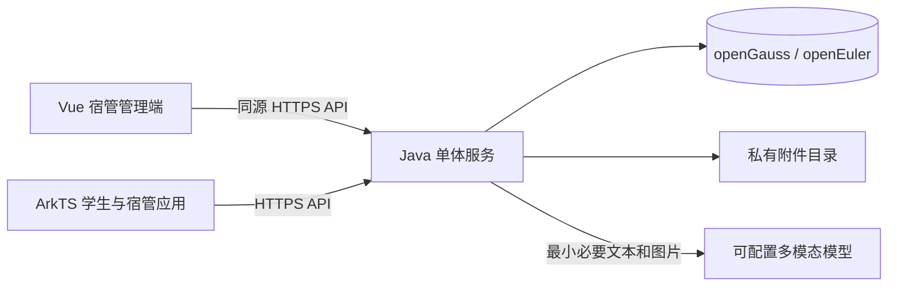
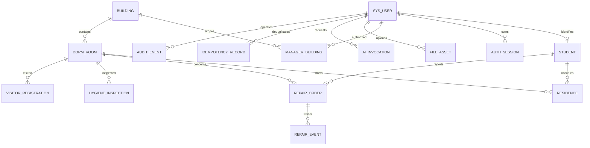

# 学生公寓综合服务管理平台架构与数据设计

当前实现核对日期：2026-11-15。单校、单实例，STUDENT／MANAGER两角色；API1.3.0及104个schema以[共享契约](../contracts/openapi.json)为准。openGauss使用[初始DDL](../backend/src/main/resources/db/opengauss/schema.sql)及同目录V2至V7有序迁移；MySQL／H2保留独立脚本。当前业务见[16](16-服务闭环与联合验收.md)、运行见[17](17-账号与恢复运行手册.md)、最新界面与验证边界见[界面收敛与交付版本](18-界面收敛与交付版本.md)。历史迁移快照见[10](10-openGauss迁移与验收.md)，不视为当前全库规模。

## 技术方案

采用模块化 Java 单体、Vue 管理端和原生 ArkTS 鸿蒙应用。宿管在 Web 维护档案、处理数据与查看统计，在鸿蒙应用完成现场业务；学生使用鸿蒙应用报修和查看自己的服务记录。

| 层次 | 当前实现 | 实施依据与边界 |
| --- | --- | --- |
| 后端 | Spring Boot 4.1.2、Spring Security；Java release21 | 已使用本机JDK25.0.4编译和运行，版本见pom.xml |
| 数据访问 | 参数化 Spring JDBC、显式SQL与事务 | 当前未使用MyBatis-Plus；业务行锁、唯一约束、版本条件和事务内幂等由服务实现 |
| 数据库 | openEuler虚拟机现有openGauss-lite7.0.0-RC1，项目独立PG兼容库 | org.opengauss JDBC6.0.6-og；实际迁移与目标库验收状态见10；旧MySQL8.4源库及H2本地profile保留 |
| Web | Vue3、TypeScript、Vite、Vue Router、Lucide1.0.0、原生CSS/表格/统计 | npm与锁文件管理；未引入Pinia、Element Plus或ECharts，沿用已批准R3暖白/暖黑设计 |
| 鸿蒙 | 原生ArkTS、ArkUI Stage、单entry HAP，API24 | 一个App按后端角色展示学生或宿管页面；本机Pura90模拟器已安装运行 |
| 文件 | 服务私有目录、SQL附件元信息 | 鉴权上传/下载，真实解码与重编码；数据库和附件需配套备份 |
| 调度 | 独立纯Java RoutePlanner与有界插入／局部改善 | 不依赖AI或外部地图服务；事务外计算，版本与快照指纹控制发布 |
| AI | AiGateway共用DeepSeek HTTP／配额，学生助手与ManagerAssistService各管场景 | AiRequestLedger短事务幂等；11月13日官方纯文本宿管研判及反馈已实测；官方附图／值班简报真实调用未验收，详见16 |
| 构建与运行 | Maven Wrapper3.9.12、npm、DevEco配套Hvigor/ohpm | scripts默认连接openGauss，保留显式MySQL／H2回退及独立数据迁移工具；当前未进行生产部署 |

框架可行性参考[Spring Boot系统要求](https://docs.spring.io/spring-boot/system-requirements.html)，当前锁定与编译结果以项目pom.xml和测试报告为准。初步方案中的MyBatis-Plus已由Spring JDBC替代，以直接表达行锁、事务和权限条件，不维护另一套Mapper层。

后端继续沿用已验证的Spring Boot4.1.2，不因数据库替换变更Web／鸿蒙技术栈或引入新的ORM。原MySQL8.4作为迁移源及显式回退环境保留。

依赖继续由各端构建文件与锁文件管理。Spring按profile执行初始DDL，再由SchemaMigrations顺序读取对应V2至V7脚本、记录checksum；openGauss使用独立PG DDL，MySQL／H2历史文件不改写。已应用脚本校验和变化会拒绝启动，不能把不同方言脚本当作同一已应用迁移；数据迁移工具单独处理目标控制表。重复启动不重建既有业务，未来结构变更新增迁移。

Web 的 Node 与 DevEco 的 Node 分开管理。Vue 当前快速开始要求 `^22.18.0 || >=24.12.0`，比单看 Vite 最低要求更严格，Web 建议 Node 24 LTS 对应补丁；鸿蒙使用本机 DevEco 配套运行时，不把全局 Node 强行替代其工具链。[Vue 快速开始](https://vuejs.org/guide/quick-start.html)、[Vite 指南](https://vite.dev/guide/)。

## 系统结构

Java位于`cn.dormlink`，按领域划分包，控制器、读写服务与SQL读取边界共同保持模块职责。当前模块如下；具体类和约束以14／15／16及源码为准。

| 包 | 主要职责 |
| --- | --- |
| identity | 可撤销会话、账号状态、密码及楼栋授权 |
| housing | 楼栋房间、学生档案、入住／调宿／退宿 |
| repairs | 工单读取、动作、处理凭证、确认和事件轨迹 |
| dispatch | 活跃资格、规划输入快照、纯RoutePlanner、计划发布和执行／交接 |
| mobility | 工作会话、观测来源与位置屏障、锚点、通行样本及校准 |
| fieldservice | 访客和卫生巡检、留痕与复查 |
| followup | 服务消息、跟进、卫生整改和反馈闭环 |
| assistance | 学生建议、宿管只读研判／简报、HTTP网关、限额及请求账本 |
| media | 私有图片校验、重编码、权限继承、绑定及回收 |
| reporting | 授权范围统计、口径及聚合查询 |
| shared | JDBC、迁移、幂等、异常、审计等公共基础能力 |

`DispatchPresence`核对账号活跃资格，`DispatchRepository`读取一致快照并发布版本，`DispatchCoordinator`在事务外规划；`DispatchService`组织看板／配置，`DispatchExecutionService`组织认领、出发到达和交接。算法不访问SQL或HTTP。AI网关共用配额和审计，外部调用不占用业务SQL锁。

Web以composables/useManagerPresence、useDispatchBoard及独立dispatch组件维护会话和路线，ManagerAssist独立展示AI。鸿蒙以features/dispatch、features/visits、features/assist分离心跳／版本、访问安排和AI。模型均从OpenAPI生成；不引入微服务、Redis或消息队列。

正式工程位于 `backend/`、`web/`、`harmony/`，`deploy/`与`scripts/`负责本机运行；`docs/`和`design/`保留方案与视觉参照。两种客户端共用 `/api/v1` 和 `contracts/openapi.json`，TypeScript与ArkTS模型均从共享schema生成，不各自手写响应类型；UI分别使用Vue和原生ArkUI实现。

## 权限和身份

账号由项目种子数据和受控初始化流程创建；首版无公开注册、任意角色切换和在线权限管理菜单。`sys_user.role` 是服务端唯一业务角色来源。宿管楼栋范围从 `manager_building` 读取，前端传入的楼栋、学生、工单 ID 只作为查询条件，不能扩大范围。

采用Spring Security加可撤销随机会话，数据库只保存标识摘要，绝对有效期8小时。Web使用HttpOnly、SameSite Cookie，Cookie身份写请求校验CSRF；本机HTTP联调默认非Secure，HTTPS部署需设COOKIE_SECURE=true。鸿蒙通过Authorization Bearer发送标识，当前仅存内存，退出、401及改密时清除。后端每次检查会话、账号和当前数据授权；禁用、改密、登出撤销会话，无自动续期。

| 资源 | 学生查询条件 | 宿管查询条件 |
| --- | --- | --- |
| 入住 | `student.user_id = current_user`，包含本人历史 | 历史记录对应楼栋在当前授权内 |
| 报修 | `reporter_student_id = current_student`，搬宿后仍可查看本人历史 | 工单提交时的楼栋在授权内 |
| 卫生 | 检查时刻落在本人该房间的有效入住区间内，只返回分数、问题和整改内容 | 检查记录所属楼栋在授权内 |
| 访客 | 无权限 | 访客到访楼栋在授权内 |
| 附件 | 本人未绑定上传；或绑定业务对本人可读且附件阶段可见 | 本人未绑定上传；或绑定业务在楼栋授权内 |
| 统计 | 只提供本人服务概况 | SQL 聚合前限定授权楼栋，包含导出和图表 |

任何详情、列表、计数、导出、状态更新、附件下载都执行同样的数据范围规则。对无权访问的具体资源统一返回 404，避免枚举；有资源范围但无动作权限返回 403。

## 数据实体与关系

五类核心记录仍为student、dorm_room、visitor_registration、repair_order、hygiene_inspection。初始DDL及V2—V7的当前模型共36表、361字段、59条外键，含schema_migration；无床位实体。22表／567行只对应11月11日迁移快照。

计划推荐与dispatch_task实际认领分开；唯一有效占用、防同时在途／到场、冻结行程前缀、事务内授权和双版本仍由服务与数据库共同约束。设备观测不是考勤，整改／消息和AI反馈分别记录，不覆盖既有维修和巡检历史。

下图仅展示核心业务关系，不是36表完整物理模型。

公共字段约定：业务 ID 为 `BIGINT`，API以字符串传输，避免JavaScript数值精度问题；openGauss自增列使用 `BIGSERIAL`。写入时间为 `TIMESTAMP(3)`，数据库会话与JDBC读写显式使用UTC，API返回带时区ISO8601，界面按Asia/Shanghai展示。检查日期为本地 `DATE`，布尔使用 `BOOLEAN`。可修改主记录有 `version INT NOT NULL DEFAULT 0`、`created_at`、`updated_at`；历史事件只追加。

### 当前表清单与约束

字段类型、长度、索引及约束以实际SQL和契约为准；下表按初始DDL及V2—V7合并核对，避免维护一份会遗漏后续迁移的简化字段表。

| 表 | 用途 | 字段数 |
| --- | --- | --- |
| `sys_user` | 账号 | 9 |
| `auth_session` | 会话 | 9 |
| `building` | 楼栋 | 6 |
| `manager_building` | 宿管楼栋权限 | 2 |
| `student` | 学生档案 | 12 |
| `dorm_room` | 宿舍房间 | 8 |
| `residence` | 入住历史 | 12 |
| `visitor_registration` | 访客 | 16 |
| `repair_order` | 报修工单 | 31 |
| `repair_event` | 维修事件 | 9 |
| `hygiene_inspection` | 卫生巡检 | 22 |
| `file_asset` | 私有附件 | 12 |
| `audit_event` | 审计 | 9 |
| `idempotency_record` | 幂等账本 | 8 |
| `ai_invocation` | AI调用 | 8 |
| `dispatch_manager` | 宿管调度配置 | 7 |
| `dispatch_revision` | 调度版本 | 7 |
| `dispatch_task` | 执行任务 | 10 |
| `dispatch_plan` | 计划快照 | 6 |
| `dispatch_event` | 调度事件 | 6 |
| `dispatch_travel` | 人工通行基线 | 5 |
| `field_work_session` | 现场工作会话 | 17 |
| `campus_anchor` | 校园锚点 | 10 |
| `manager_context_snapshot` | 设备上下文 | 17 |
| `mobility_batch_receipt` | 观测批次回执 | 5 |
| `mobility_pending_leg` | 待闭合通行段 | 7 |
| `travel_leg_summary` | 通行样本摘要 | 10 |
| `mobility_travel_model` | 共享通行模型 | 8 |
| `mobility_model_revision` | 模型修订 | 9 |
| `mobility_personal_travel_model` | 个人通行校准 | 7 |
| `service_message` | 服务消息 | 17 |
| `service_followup_lock` | 跟进互斥 | 5 |
| `hygiene_remediation` | 卫生整改 | 18 |
| `ai_advice_order` | 建议关联工单 | 4 |
| `ai_advice_feedback` | 建议使用及结果 | 9 |
| `schema_migration` | 迁移版本与校验和 | 4 |

当前SQL使用可空唯一列active_student_id，服务端在入住/退宿事务内维护，并以CHECK验证其与checked_out_at及student_id一致；允许多条已结束入住。卫生以active_guard配合 `(room_id, inspection_date, round, active_guard)` 唯一约束，作废时清空guard并保留原记录。为兼容MySQL与H2，实际初始结构未采用生成列。

工单处理结果保存在 FINISH 类型的 `repair_event.note`，不是覆盖式的单一 order.result 字段；详情将最近一次 FINISH 事件及其处理凭证组合成当前处理结果，返修后此前结果仍在完整事件轨迹中。每张处理凭证额外记录 `repair_event_id`，避免多次返修后无法区分照片属于哪次处理。

所有普通关联字段使用外键和 `RESTRICT` 删除策略；文件的多态业务绑定、审计目标和幂等资源由应用服务在同事务验证，不伪造数据库多态外键。`residence.building_id` 等冗余范围字段由 room 推导并写入，客户端不能指定；档案改名仅改变当前显示名，快照仍用于历史。已有业务引用的房间不能直接改所属楼栋，应停用后另建档案；不能靠迁移档案让历史范围发生变化。

卫生等级固定为：90~100 优秀，80~89 良好，60~79 合格，0~59 待整改。等级由总分推导，不接受客户端直接上传等级。检查时刻 `inspected_at` 决定学生的可见入住区间，日期与轮次用于去重；日期不能替代精确入住时间。

## 事务与并发

### 入住和调宿

入住事务先锁学生行，再锁目标房间行；使用当前读锁定查询未退宿记录，验证学生未重复入住、房间启用和人数小于容量，最后插入入住记录。唯一索引提供第二道约束。不能以“先 count 再 insert”且不锁房间的方式处理最后一个名额。

调宿在一个事务内锁学生行，再按房间 ID 升序锁旧房和新房，验证两边楼栋授权和新房容量，同一时刻结束旧入住并建立新入住。事务失败全部回滚。修改房间容量也先锁房间，不能减少到低于当前在住人数。历史记录采用半开区间 `[checked_in_at, checked_out_at)`，当前记录结束时间为空。

### 工单流转

详情返回 `version`；动作请求带 `expectedVersion`。服务器校验当前角色、楼栋、办理人和合法迁移，再执行 `UPDATE ... WHERE id=? AND version=? AND status=?`，成功后 version 加一，在同一事务插入 `repair_event` 和审计。影响行数为0则409并要求刷新。两名宿管同时受理只允许一人成功，不能由后一次写入覆盖办理人。

状态动作仅采用需求文档的迁移表。`PENDING_CONFIRMATION` 可由报修学生拒绝完工或原办理宿管提出返工回到 `PROCESSING`，必填原因；`COMPLETED`、`CANCELLED`、`REJECTED` 均为终态。再次故障建立关联新单，保留原单历史。

创建工单同时绑定本人 TEMP 故障图片，创建和绑定失败一起回滚。客户端以 `Idempotency-Key` 防止网络重试生成两单，状态迁移同时使用幂等键与版本保护。幂等记录和业务写入同一事务；提交响应丢失时重试返回原资源，不能重新执行动作。

### 访客和卫生

登记时校验被访学生当前入住与目标房间一致，并校验楼栋范围。离开登记使用 `left_at IS NULL` 条件和版本，重复同键操作返回原结果。宿管可为授权楼栋的未离开访客补录离开时间；离开后如确有录错，走显式更正并留审计。

卫生新建通过有效记录唯一索引防重复；修改携带版本和更正原因，在审计中保存变化前后分数、问题、检查时刻及操作者，学生只能读取当前有效结果。低于60分必须填写问题。不能用重新创建一条同轮次记录绕过改分审计。作废后新记录使用 related_inspection_id 关联原记录并填写原因；真实复查使用新轮次并关联原巡检。检查时刻的修正会影响学生可见范围，必须同时写审计，不能用日期覆盖时间判权。

## 附件和部署安全

允许 JPEG、PNG、WebP，每张不超过10MB。故障图片最多6张；处理凭证独立最多6张；每次巡检最多6张。服务端校验实际文件特征、尺寸上限和可解码性，重编码并去除 EXIF，文件名转换成随机 storage key。不得仅依赖前端 accept 属性或客户端 MIME。HEIC 由客户端转换为允许格式，转换失败提示重新选图。

上传先获得 TEMP 文件 ID；未绑定仅上传者可读，绑定后按业务权限读取；附件不能被其它学生抢绑，同一文件不能反复绑定不同工单。故障图片在工单提交前可删除，提交后原始证据只允许追加更正说明；处理凭证随完工动作提交。未绑定超过24小时的附件由单体定时任务清理，清理时先校验未被事务绑定。

私有存储目录不在 Web 静态根目录。下载 `/files/{id}/content` 每次鉴权，不返回可猜物理路径；缩略图同样鉴权。生产使用 HTTPS，禁止跨公网开放数据库；Web Cookie 仅同源，CORS 精确允许开发地址。日志中的手机号脱敏，访客姓名及联系方式不进入模型输入。

单机部署要备份数据库和附件，并做一次还原演练；两者属于同一恢复集合。访客默认保留90天后匿名化姓名/电话，业务事件保留计数；该保留期是项目建议，可按学校实际制度调整。学生离校停用账号，历史工单与检查轨迹不随档案删除。

## 验证重点

实施时优先验证四条跨端链路：学生上传图片并报修 → Web 受理 → 鸿蒙宿管处理 → 学生确认；并行入住争抢最后一个名额；学生换 ID 查询他人工单及附件；AI 超时后正常手工提交。再覆盖跨楼栋宿管越权、重复请求幂等、非法迁移、卫生边界值和重复轮次。

初始验收规模与需求文档一致：约5000名学生、1000间房、20000张历史工单，20个并发用户下普通列表和详情接口 P95≤2秒，图片与 AI 单独统计。这是需求目标；已经有本机不同规模负载记录，详见14／16。各轮数据集和并发口径不同，不能用小规模混合负载替代此目标或生产SLA。列表默认20条、最多100条，排序字段白名单；可选导出权限和数据范围与查询一致。

方案资料检索日期为2026-11-07。当前依赖、工具与设备版本见[环境说明](05-实施路线与环境.md)，早期编译与联调记录保留在[07](07-开发与验收.md)，当前业务及最新界面验证分别见16／18；本文的设计字段表不代替共享契约与实际SQL。
