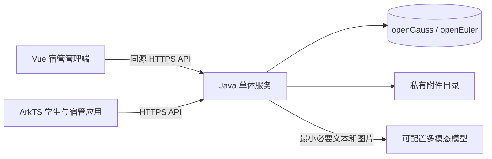
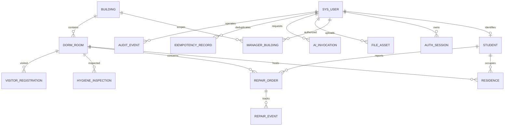

# 学生公寓综合服务管理平台架构与数据设计

更新基线：2026-11-11，数据库已切换为openEuler上的openGauss并完成本轮数据保留与三端验证，动态多宿管路线与管理AI保持原模块边界。单校、单实例，仍只有STUDENT／MANAGER两种角色。API以[共享契约](../contracts/openapi.json)为准；openGauss结构见[PG初始DDL](../backend/src/main/resources/db/opengauss/schema.sql)与[PG V2迁移](../backend/src/main/resources/db/opengauss/V2__dynamic_dispatch.sql)，原MySQL／H2脚本保留。[07](07-开发与验收.md)及[09](09-动态调度交付与验收.md)是此前MySQL验收，本轮证据见[10](10-openGauss迁移与验收.md)。

## 技术方案

采用模块化 Java 单体、Vue 管理端和原生 ArkTS 鸿蒙应用。宿管在 Web 维护档案、处理数据与查看统计，在鸿蒙应用完成现场业务；学生使用鸿蒙应用报修和查看自己的服务记录。

| 层次 | 当前实现 | 实施依据与边界 |
| --- | --- | --- |
| 后端 | Spring Boot 4.1.2、Spring Security；Java release21 | 已使用本机JDK25.0.4编译和运行，版本见pom.xml |
| 数据访问 | 参数化 Spring JDBC、显式SQL与事务 | 当前未使用MyBatis-Plus；业务行锁、唯一约束、版本条件和事务内幂等由服务实现 |
| 数据库 | openEuler虚拟机现有openGauss-lite7.0.0-RC1，项目独立PG兼容库 | org.opengauss JDBC6.0.6-og；实际迁移与目标库验收状态见10；旧MySQL8.4源库及H2本地profile保留 |
| Web | Vue3、TypeScript、Vite、Vue Router、原生CSS/表格/统计 | npm与锁文件管理；未引入Pinia、Element Plus或ECharts，沿用已批准R3暖白/暖黑设计 |
| 鸿蒙 | 原生ArkTS、ArkUI Stage、单entry HAP，API24 | 一个App按后端角色展示学生或宿管页面；本机Pura90模拟器已安装运行 |
| 文件 | 服务私有目录、SQL附件元信息 | 鉴权上传/下载，真实解码与重编码；数据库和附件需配套备份 |
| 调度 | 独立纯Java RoutePlanner与有界插入／局部改善 | 不依赖AI或外部地图服务；事务外计算，版本与快照指纹控制发布 |
| AI | AiGateway共用DeepSeek HTTP／配额，学生助手与ManagerAssistService各管场景 | AiRequestLedger短事务幂等；当前真实密钥为空，官方调用未测 |
| 构建与运行 | Maven Wrapper3.9.12、npm、DevEco配套Hvigor/ohpm | scripts默认连接openGauss，保留显式MySQL／H2回退及独立数据迁移工具；当前未进行生产部署 |

框架可行性参考[Spring Boot系统要求](https://docs.spring.io/spring-boot/system-requirements.html)，当前锁定与编译结果以项目pom.xml和测试报告为准。初步方案中的MyBatis-Plus已由Spring JDBC替代，以直接表达行锁、事务和权限条件，不维护另一套Mapper层。

后端继续沿用已验证的Spring Boot4.1.2，不因数据库替换变更Web／鸿蒙技术栈或引入新的ORM。原MySQL8.4作为迁移源及显式回退环境保留。

依赖继续由各端构建文件与锁文件管理。Spring按profile执行初始DDL，再由SchemaMigrations读取对应V2脚本、记录checksum；openGauss使用独立PG DDL，MySQL／H2历史文件不改写。已应用脚本校验和变化会拒绝启动，不能把不同方言脚本当作同一已应用迁移；数据迁移工具单独处理目标控制表。重复启动不重建既有业务，未来结构变更新增迁移。

Web 的 Node 与 DevEco 的 Node 分开管理。Vue 当前快速开始要求 `^22.18.0 || >=24.12.0`，比单看 Vite 最低要求更严格，Web 建议 Node 24 LTS 对应补丁；鸿蒙使用本机 DevEco 配套运行时，不把全局 Node 强行替代其工具链。[Vue 快速开始](https://vuejs.org/guide/quick-start.html)、[Vite 指南](https://vite.dev/guide/)。

## 系统结构

Java位于cn.dormlink，原业务服务继续负责鉴权、住房、维修、现场服务、统计和附件。动态调度与AI新增独立职责，不继续堆入原Controller或UI主页面：

| 模块 | 唯一主要职责 |
| --- | --- |
| dispatch/RoutePlanner | 不可变快照输入、可行插入、冻结前缀、有界后缀／跨路线改善与不可行原因；无SQL、会话、HTTP |
| DispatchPresence | 会话心跳、账号去重、可用意愿／位置／截止时间及资格 |
| DispatchRepository | 一致快照、计划／任务持久化、指纹及版本发布 |
| DispatchCoordinator／DispatchSignals | 提交后合并事件、定时重算、事务外调用算法、最多3次冲突重试 |
| DispatchService | 授权路线视图、认领、执行互斥、受阻恢复、通行配置；交接复用RepairService受控事务 |
| AiGateway／AiRequestLedger | 共用HTTP、限额、用量／失败审计；短事务准入与冻结结果重放，不持SQL锁等待模型 |
| AiService／ManagerAssistService | 分别组织学生填写、宿管单单研判／简报；后者只读、基于授权事实、规范化脱敏 |

Web以composables/useManagerPresence、useDispatchBoard及独立dispatch组件维护会话和路线，ManagerAssist独立展示AI。鸿蒙以features/dispatch、features/visits、features/assist分离心跳／版本、访问安排和AI。模型均从OpenAPI生成；不引入微服务、Redis或消息队列。

正式工程位于 `backend/`、`web/`、`harmony/`，`deploy/`与`scripts/`负责本机运行；`docs/`和`design/`保留方案与视觉参照。两种客户端共用 `/api/v1` 和 `contracts/openapi.json`，TypeScript与ArkTS模型均从共享schema生成，不各自手写响应类型；UI分别使用Vue和原生ArkUI实现。

## 权限和身份

账号由项目种子数据和受控初始化流程创建；首版无公开注册、任意角色切换和在线权限管理菜单。`sys_user.role` 是服务端唯一业务角色来源。宿管楼栋范围从 `manager_building` 读取，前端传入的楼栋、学生、工单 ID 只作为查询条件，不能扩大范围。

采用Spring Security加可撤销随机会话，数据库只保存标识摘要，绝对有效期8小时。Web使用HttpOnly、SameSite Cookie，Cookie身份写请求校验CSRF；本机HTTP联调默认非Secure，HTTPS部署需设COOKIE_SECURE=true。鸿蒙通过Authorization Bearer发送标识，当前仅存内存，退出、401及改密时清除。后端每次检查会话、账号和当前数据授权；禁用、改密、登出撤销会话，无自动续期。

| 资源 | 学生查询条件 | 宿管查询条件 |
| --- | --- | --- |
| 入住 | `student.user_id = current_user`，包含本人历史 | 历史记录对应楼栋在当前授权内 |
| 报修 | `reporter_student_id = current_student`，搬宿后仍可查看本人历史 | 工单提交时的楼栋在授权内 |
| 卫生 | 检查时刻落在本人该房间的有效入住区间内，只返回分数、问题和整改内容 | 检查记录所属楼栋在授权内 |
| 访客 | 无权限 | 访客到访楼栋在授权内 |
| 附件 | 本人未绑定上传；或绑定业务对本人可读且附件阶段可见 | 本人未绑定上传；或绑定业务在楼栋授权内 |
| 统计 | 只提供本人服务概况 | SQL 聚合前限定授权楼栋，包含导出和图表 |

任何详情、列表、计数、导出、状态更新、附件下载都执行同样的数据范围规则。对无权访问的具体资源统一返回 404，避免枚举；有资源范围但无动作权限返回 403。

## 数据实体与关系

五张核心表仍为student、dorm_room、visitor_registration、repair_order、hygiene_inspection，基础业务及支撑表为15张。V2另增加调度表及schema_migration登记，未增加床位实体。动态表分别保存dispatch_manager账号意愿／位置、dispatch_task唯一有效占用与执行状态、dispatch_revision输入／计划版本、dispatch_plan追加快照、dispatch_event事件、dispatch_travel通行估算；auth_session追加心跳，repair_order追加结构化窗口、确认、估计时长及上门／等待信息。

计划推荐与dispatch_task真实认领分开；active_order_id唯一约束防重复占用，执行动作还在事务内校验同一宿管不能同时EN_ROUTE／ON_SITE两站。任务BLOCKED保留责任，恢复ASSIGNED不回退维修状态；维修到待确认／终态后不继续作为上门站点。当前主库V2升级已保留旧业务，数据备份只存本机受控位置，不随交付文档发布。

公共字段约定：业务 ID 为 `BIGINT`，API以字符串传输，避免JavaScript数值精度问题；openGauss自增列使用 `BIGSERIAL`。写入时间为 `TIMESTAMP(3)`，数据库会话与JDBC读写显式使用UTC，API返回带时区ISO8601，界面按Asia/Shanghai展示。检查日期为本地 `DATE`，布尔使用 `BOOLEAN`。可修改主记录有 `version INT NOT NULL DEFAULT 0`、`created_at`、`updated_at`；历史事件只追加。

### 表字段与约束

| 表 | 主要字段及建议类型 | 关键约束和索引 |
| --- | --- | --- |
| `sys_user` | `id`、`username VARCHAR(64)`、`password_hash VARCHAR(255)`、`display_name VARCHAR(50)`、`role VARCHAR(16)`、`enabled BOOLEAN` | username 唯一；role 仅 STUDENT/MANAGER；密码用 BCrypt；禁用代替删除 |
| `auth_session` | `id`、`user_id`、`token_hash CHAR(64)`、`client_type VARCHAR(16)`、`expires_at`、`revoked_at`、`created_at` | token_hash 唯一；索引 user_id/expires_at；不存原始 token |
| `student` | `id`、`user_id`、`student_no VARCHAR(32)`、`name VARCHAR(50)`、`college VARCHAR(100)`、`major VARCHAR(100)`、`grade VARCHAR(20)`、`class_name VARCHAR(100)`、`phone VARCHAR(20)`、`status VARCHAR(16)`、`created_by` | user_id、student_no 分别唯一；status ACTIVE/INACTIVE；含学生联系方式；created_by 约束未入住档案维护范围 |
| `building` | `id`、`code VARCHAR(20)`、`name VARCHAR(50)`、`floor_count SMALLINT`、`enabled BOOLEAN` | code 唯一；楼层数正数；存在入住或进行中业务时不允许停用 |
| `manager_building` | `manager_user_id`、`building_id`、`created_at` | 复合唯一；角色必须 MANAGER；授权调整写审计 |
| `dorm_room` | `id`、`building_id`、`room_no VARCHAR(20)`、`floor_no SMALLINT`、`capacity SMALLINT`、`room_type VARCHAR(30)`、`enabled BOOLEAN` | unique(building_id,room_no)；capacity>0；索引 building_id/floor_no；不直接存学生名和逗号分隔入住人 |
| `residence` | `id`、`student_id`、`room_id`、`building_id`、`checked_in_at`、`checked_out_at`、`reason VARCHAR(200)`、`operator_id`、楼栋名/房号快照 | 退宿时间晚于入住；一名学生最多一条未退宿记录；索引 room_id/checked_out_at、student_id/checked_in_at；历史不覆盖 |
| `visitor_registration` | `id`、`visitor_name VARCHAR(50)`、`phone VARCHAR(20)`、`visited_student_id`、`room_id`、`building_id`、`purpose VARCHAR(200)`、`remark VARCHAR(500)`、`arrived_at`、`left_at`、`operator_id`、`left_operator_id`、目标学生名/房间快照 | 不收身份证号/证件照；left_at 不早于 arrived_at；索引 building_id/arrived_at、building_id/left_at；到访人及到访房间不得被调宿联动修改 |
| `repair_order` | `id`、`order_no VARCHAR(32)`、`reporter_student_id`、`residence_id`、`room_id`、`building_id`、房间快照、`contact_name_snapshot VARCHAR(50)`、`contact_phone_snapshot VARCHAR(20)`、`contact_time_slot VARCHAR(100)`、`title VARCHAR(80)`、`description VARCHAR(1000)`、`category VARCHAR(24)`、`priority VARCHAR(16)`、`status VARCHAR(32)`、`handler_user_id`、`related_order_id`、`submitted_at`、`accepted_at`、`completed_at`、`version` | order_no 唯一；类别/优先级/状态枚举校验；索引 building_id/status/submitted_at、reporter_student_id/submitted_at、handler_user_id/status；related_order_id 可空且必须同一学生可见 |
| `repair_event` | `id`、`order_id`、`from_status`、`to_status`、`action VARCHAR(32)`、`operator_id`、`operator_name_snapshot`、`note VARCHAR(1000)`、`created_at` | 索引 order_id/id；只追加，不能删除来回滚状态；备注不得只写“AI认为” |
| `hygiene_inspection` | `id`、`room_id`、`building_id`、房间快照、`inspection_date DATE`、`round VARCHAR(20)`、`inspected_at`、`floor_score TINYINT`、`desk_score TINYINT`、`bed_score TINYINT`、`bathroom_score TINYINT`、`total_score`、`issue_note VARCHAR(500)`、`remediation_note VARCHAR(500)`、`inspector_user_id`、`related_inspection_id`、`voided_at`、`version` | 地面/桌面/床铺/卫生间四项各0~25整数；总分后端计算；同房间/日期/轮次一条有效记录；索引 building_id/inspection_date；改分/作废写审计 |
| `file_asset` | `id`、`owner_user_id`、`storage_key VARCHAR(255)`、`original_name VARCHAR(150)`、`mime VARCHAR(32)`、`size_bytes BIGINT`、`sha256 CHAR(64)`、`business_type VARCHAR(24)`、`business_id BIGINT`、`repair_event_id`、`phase VARCHAR(20)`、`state VARCHAR(16)`、`created_at` | storage_key 唯一；business_type REPAIR/HYGIENE 或空；phase REPORT/RESULT/INSPECTION；state TEMP/BOUND/DELETED；索引 owner_user_id/state、business_type/business_id；绑定业务由服务校验，处理凭证关联本次FINISH事件 |
| `audit_event` | `id`、`operator_id`、`action VARCHAR(64)`、`business_type`、`business_id`、`changed_fields JSON`、`trace_id VARCHAR(64)`、`created_at` | 索引 business_type/business_id/created_at、operator_id/created_at；敏感字段脱敏，不记录密码/token/图片原文 |
| `idempotency_record` | `id`、`user_id`、`method`、`route_key VARCHAR(100)`、`request_key VARCHAR(64)`、`request_hash CHAR(64)`、`resource_id`、`response_status`、`state VARCHAR(16)`、`expires_at` | unique(user_id,method,route_key,request_key)；同key异请求返回409；过期清理，默认保留24h |
| `ai_invocation` | `id`、`user_id`、`task_type VARCHAR(24)`、`provider VARCHAR(40)`、`model VARCHAR(80)`、`prompt_version VARCHAR(20)`、`status`、`latency_ms INT`、`input_tokens INT`、`output_tokens INT`、`cost_estimate DECIMAL(12,6)`、`trace_id`、`created_at` | 索引 user_id/created_at、status/created_at；不默认保存故障图片和完整输入；任务仅为辅助，不替代repair_event |

当前SQL使用可空唯一列active_student_id，服务端在入住/退宿事务内维护，并以CHECK验证其与checked_out_at及student_id一致；允许多条已结束入住。卫生以active_guard配合 `(room_id, inspection_date, round, active_guard)` 唯一约束，作废时清空guard并保留原记录。为兼容MySQL与H2，实际初始结构未采用生成列。

工单处理结果保存在 FINISH 类型的 `repair_event.note`，不是覆盖式的单一 order.result 字段；详情将最近一次 FINISH 事件及其处理凭证组合成当前处理结果，返修后此前结果仍在完整事件轨迹中。每张处理凭证额外记录 `repair_event_id`，避免多次返修后无法区分照片属于哪次处理。

所有普通关联字段使用外键和 `RESTRICT` 删除策略；文件的多态业务绑定、审计目标和幂等资源由应用服务在同事务验证，不伪造数据库多态外键。`residence.building_id` 等冗余范围字段由 room 推导并写入，客户端不能指定；档案改名仅改变当前显示名，快照仍用于历史。已有业务引用的房间不能直接改所属楼栋，应停用后另建档案；不能靠迁移档案让历史范围发生变化。

卫生等级固定为：90~100 优秀，80~89 良好，60~79 合格，0~59 待整改。等级由总分推导，不接受客户端直接上传等级。检查时刻 `inspected_at` 决定学生的可见入住区间，日期与轮次用于去重；日期不能替代精确入住时间。

## 事务与并发

### 入住和调宿

入住事务先锁学生行，再锁目标房间行；使用当前读锁定查询未退宿记录，验证学生未重复入住、房间启用和人数小于容量，最后插入入住记录。唯一索引提供第二道约束。不能以“先 count 再 insert”且不锁房间的方式处理最后一个名额。

调宿在一个事务内锁学生行，再按房间 ID 升序锁旧房和新房，验证两边楼栋授权和新房容量，同一时刻结束旧入住并建立新入住。事务失败全部回滚。修改房间容量也先锁房间，不能减少到低于当前在住人数。历史记录采用半开区间 `[checked_in_at, checked_out_at)`，当前记录结束时间为空。

### 工单流转

详情返回 `version`；动作请求带 `expectedVersion`。服务器校验当前角色、楼栋、办理人和合法迁移，再执行 `UPDATE ... WHERE id=? AND version=? AND status=?`，成功后 version 加一，在同一事务插入 `repair_event` 和审计。影响行数为0则409并要求刷新。两名宿管同时受理只允许一人成功，不能由后一次写入覆盖办理人。

状态动作仅采用需求文档的迁移表。`PENDING_CONFIRMATION` 可由报修学生拒绝完工或原办理宿管提出返工回到 `PROCESSING`，必填原因；`COMPLETED`、`CANCELLED`、`REJECTED` 均为终态。再次故障建立关联新单，保留原单历史。

创建工单同时绑定本人 TEMP 故障图片，创建和绑定失败一起回滚。客户端以 `Idempotency-Key` 防止网络重试生成两单，状态迁移同时使用幂等键与版本保护。幂等记录和业务写入同一事务；提交响应丢失时重试返回原资源，不能重新执行动作。

### 访客和卫生

登记时校验被访学生当前入住与目标房间一致，并校验楼栋范围。离开登记使用 `left_at IS NULL` 条件和版本，重复同键操作返回原结果。宿管可为授权楼栋的未离开访客补录离开时间；离开后如确有录错，走显式更正并留审计。

卫生新建通过有效记录唯一索引防重复；修改携带版本和更正原因，在审计中保存变化前后分数、问题、检查时刻及操作者，学生只能读取当前有效结果。低于60分必须填写问题。不能用重新创建一条同轮次记录绕过改分审计。作废后新记录使用 related_inspection_id 关联原记录并填写原因；真实复查使用新轮次并关联原巡检。检查时刻的修正会影响学生可见范围，必须同时写审计，不能用日期覆盖时间判权。

## 附件和部署安全

允许 JPEG、PNG、WebP，每张不超过10MB。故障图片最多6张；处理凭证独立最多6张；每次巡检最多6张。服务端校验实际文件特征、尺寸上限和可解码性，重编码并去除 EXIF，文件名转换成随机 storage key。不得仅依赖前端 accept 属性或客户端 MIME。HEIC 由客户端转换为允许格式，转换失败提示重新选图。

上传先获得 TEMP 文件 ID；未绑定仅上传者可读，绑定后按业务权限读取；附件不能被其它学生抢绑，同一文件不能反复绑定不同工单。故障图片在工单提交前可删除，提交后原始证据只允许追加更正说明；处理凭证随完工动作提交。未绑定超过24小时的附件由单体定时任务清理，清理时先校验未被事务绑定。

私有存储目录不在 Web 静态根目录。下载 `/files/{id}/content` 每次鉴权，不返回可猜物理路径；缩略图同样鉴权。生产使用 HTTPS，禁止跨公网开放数据库；Web Cookie 仅同源，CORS 精确允许开发地址。日志中的手机号脱敏，访客姓名及联系方式不进入模型输入。

单机部署要备份数据库和附件，并做一次还原演练；两者属于同一恢复集合。访客默认保留90天后匿名化姓名/电话，业务事件保留计数；该保留期是项目建议，可按学校实际制度调整。学生离校停用账号，历史工单与检查轨迹不随档案删除。

## 验证重点

实施时优先验证四条跨端链路：学生上传图片并报修 → Web 受理 → 鸿蒙宿管处理 → 学生确认；并行入住争抢最后一个名额；学生换 ID 查询他人工单及附件；AI 超时后正常手工提交。再覆盖跨楼栋宿管越权、重复请求幂等、非法迁移、卫生边界值和重复轮次。

初始验收规模与需求文档一致：约5000名学生、1000间房、20000张历史工单，20个并发用户下普通列表和详情接口 P95≤2秒，图片与 AI 单独统计。这是待实施验证的目标，当前没有负载实测结果。列表默认20条、最多100条，排序字段白名单；可选导出权限和数据范围与查询一致。

方案资料检索日期为2026-11-07。当前依赖、工具与设备版本见[环境说明](05-实施路线与环境.md)，实际编译、HTTP、浏览器及设备验证见[开发与验收](07-开发与验收.md)；本文的设计字段表不代替共享契约与实际SQL。
