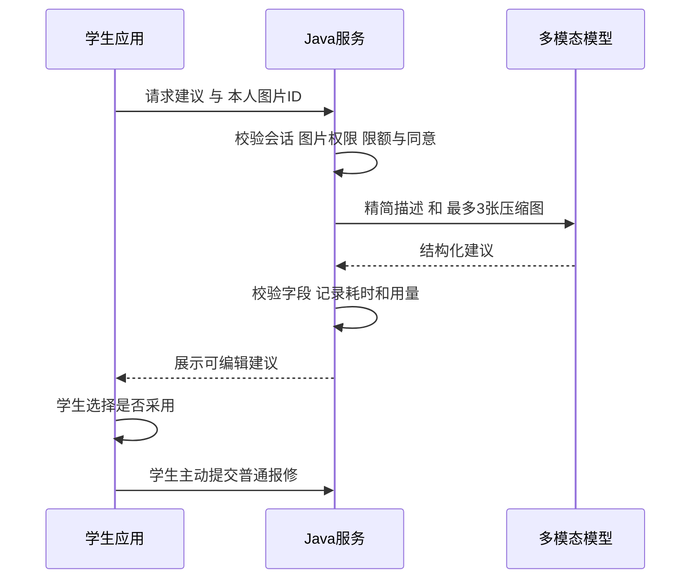

# 学生公寓综合服务管理平台接口与AI方案

设计基线：2026-11-07，已增加动态多宿管路线、结构化访问安排与宿管AI。三端共用/api/v1和[OpenAPI](../contracts/openapi.json)，类型由schema生成；服务器负责身份、楼栋范围、版本、状态及附件权限。基础版本证据保留在07，本轮交付见[09](09-动态调度交付与验收.md)。AI分为学生填写建议和宿管只读辅助，不替代调度算法或人工业务动作。

## 接口约定

所有 ID 使用字符串，时间使用带时区 ISO 8601；本地日期 `YYYY-MM-DD`。列表采用 `page=1&pageSize=20`，最大100，筛选如 buildingId、status、startDate、endDate；排序只允许服务端白名单。学生列表接口自动叠加本人条件，宿管接口自动叠加楼栋授权，前端不拼接权限 SQL。

普通成功返回 HTTP 200，新建返回201：

```json
{
  "data": { "id": "10001", "status": "SUBMITTED", "version": 0 },
  "traceId": "demo-6a84"
}
```

分页 `data` 为 `{ "items": [], "total": 0, "page": 1, "pageSize": 20 }`。错误保留真实 HTTP 状态：400 参数格式；401 会话无效；403 动作无权；404 资源不可见或不存在；409 版本/容量/重复轮次冲突；413 图片超限；415 类型不支持；429 限流；503 外部 AI 不可用。

```json
{
  "error": {
    "code": "REPAIR_VERSION_CONFLICT",
    "message": "工单已由其他宿管更新，请刷新后重试",
    "fieldErrors": []
  },
  "traceId": "demo-6a84"
}
```

非查询业务请求使用 `Idempotency-Key`，客户端生成随机 UUID，并在同一次提交重试时复用；用户改内容后生成新 key。相同用户、方法、路由、key 对应相同规范化请求摘要才返回原响应。不同内容复用 key 返回 `IDEMPOTENCY_KEY_REUSED` 409。表单提交期间禁用按钮只是体验保护，不能代替后端幂等。

会话方案参见架构文档。Web Cookie 请求附 CSRF header；鸿蒙 Bearer 请求禁止把 token 放到 URL。所有失败展示可读提示和 traceId，不向客户端返回 SQL、模型密钥或服务器文件路径。

## 页面路由

| 平台 | 主要路由或页面 | 页面职责 |
| --- | --- | --- |
| Web | `/login`、`/dashboard` | 宿管登录、授权楼栋总览与待办 |
| Web | `/housing/rooms`、`/housing/rooms/:id` | 楼栋/房间档案、容量、当前入住和历史 |
| Web | `/housing/students`、`/housing/residences` | 学生维护、入住/调宿/退宿，历史查询 |
| Web | `/repairs`、`/repairs/:id` | 多条件查询、图片、时间线、允许的动作 |
| Web | `/hygiene`、`/visitors`、`/statistics` | 检查录入与更正、访客查询/离开、统计 |
| Web | `/dispatch` | 人员可用性、本人／授权路线、认领与执行、待安排原因、通行配置及受控交接 |
| 鸿蒙学生 | `StudentHome`、`RepairCreate`、`MyRepairs`、`RepairDetail`、`MyRoom`、`Profile` | 当前宿舍、AI 辅助报修、进度和完工确认、本人记录 |
| 鸿蒙宿管 | `ManagerHome`、`VisitorCreate`、`VisitorList`、`HygieneCreate`、`RepairList`、`RepairHandle`、`Profile` | 现场访客登记、离开、卫生评分和工单办理 |

上表保留逻辑信息架构；实际Web路由以web/src/router.ts为准，部分详情以页面内面板呈现，鸿蒙由单entry的角色页面与原生组件组成。学生不可打开Web宿管路由，即使绕过前端守卫，API仍拒绝宿管业务访问。

## API 清单

### 公共与基础档案

| 方法与路径 | 角色 | 关键行为 |
| --- | --- | --- |
| `POST /auth/login` | 未登录 | username/password/clientType；角色由账号读取，Web 设置 Cookie，移动端返回一次会话标识；登录失败不泄漏账号是否存在 |
| `GET /auth/csrf` | Web | 获取会话关联 CSRF token，禁止把该接口当作登录凭证 |
| `GET /auth/me` | 两者 | 返回本人基本信息、role、授权楼栋或本人当前入住摘要 |
| `POST /auth/logout` | 两者 | 撤销当前会话并清客户端凭据 |
| `POST /auth/change-password` | 两者 | 校验旧密码；成功后撤销会话并要求重新登录 |
| `GET /buildings`、`GET /rooms` | 宿管 | 仅授权楼栋；房间筛选楼栋、楼层、关键字、入住状态 |
| `GET /rooms/{id}`、`GET /students/{id}` | 宿管 | 房间详情与学生详情按当前楼栋范围；未入住学生执行下述创建人规则 |
| `POST /buildings`、`PATCH /buildings/{id}` | 宿管 | 初始楼栋由种子创建；新建楼栋只授予创建人，不能任意授予他人权限 |
| `POST /rooms`、`PATCH /rooms/{id}` | 宿管 | 维护档案；expectedVersion；禁止容量小于在住人数 |
| `GET /students`、`POST /students`、`PATCH /students/{id}` | 宿管 | 查询/维护学生档案，不能通过 student 请求修改 sys_user.role；已有在住学生必须在授权楼栋内 |
| `GET /residences` | 宿管 | 依据入住记录楼栋筛选；未入住学生的管理见下方边界 |
| `POST /residences/check-in` | 宿管 | studentId、roomId；事务检查容量和唯一当前入住 |
| `POST /residences/{id}/transfer` | 宿管 | targetRoomId、reason、expectedVersion；要求新旧楼栋都在授权内 |
| `POST /residences/{id}/check-out` | 宿管 | reason、expectedVersion；已有未完成报修提醒但不改原单归属 |
| `GET /me/residences`、`GET /me/room` | 学生 | 本人入住历史、当前房间与个人服务摘要，不返回室友个人资料 |

初始单校 MVP 允许宿管查询“未入住池”的学号、姓名、院系班级以办理入住；未入住学生的手机号仅档案创建宿管可见，默认不全量下发。当前已入住学生的编辑要求当前楼栋在范围内；无当前入住学生由其档案创建宿管维护。学生跨楼栋调宿若两端授权不在同一宿管名下，先由项目受控配置补齐联合授权，首版不增加复杂审批流程。

学生表新增 `created_by` 用于未入住档案维护范围；学生可登录前由初始化流程绑定账号。学生管理列表不混入所有历史外楼栋学生，历史入住查询与当前档案编辑分开判权。通过学号检索未入住池必须精确或分页查询，不提供全量敏感导出。

### 报修与状态动作

| 方法与路径 | 角色 | 关键行为 |
| --- | --- | --- |
| `POST /repairs` | 学生 | title、description、category、priority、contactName、contactPhone、contactTimeSlot、reportImageIds、relatedOrderId；roomId 不由客户端决定，服务器绑定当前入住 |
| `GET /repairs` | 两者 | 学生仅本人，宿管仅授权楼栋；按类别、状态、时间、房号查询 |
| `GET /repairs/{id}` | 两者 | 正文、提交房间快照、version、当前允许动作、附件摘要 |
| `GET /repairs/{id}/events` | 两者 | 追加式时间线；对学生隐藏内部审计信息 |
| `POST /repairs/{id}/accept` | 宿管 | SUBMITTED→ACCEPTED；handler 自动为当前宿管 |
| `POST /repairs/{id}/reject` | 宿管 | SUBMITTED→REJECTED；必填reason，如非宿舍设施问题 |
| `POST /repairs/{id}/start` | 办理宿管 | ACCEPTED→PROCESSING；可填处理计划 |
| `POST /repairs/{id}/finish` | 办理宿管 | PROCESSING→PENDING_CONFIRMATION；处理说明必填，resultImageIds 可选 |
| `POST /repairs/{id}/notes` | 办理宿管 | 在 ACCEPTED/PROCESSING 中追加进度说明，生成同状态事件，不改变状态 |
| `POST /repairs/{id}/confirm` | 报修学生 | PENDING_CONFIRMATION→COMPLETED；仅原报修人 |
| `POST /repairs/{id}/rework` | 报修学生或原办理宿管 | PENDING_CONFIRMATION→PROCESSING；必填原因，原办理人保持 |
| `POST /repairs/{id}/cancel` | 报修学生 | SUBMITTED→CANCELLED；受理后需要与宿管沟通，首版不提供处理中撤单 |

维修动作继续携带expectedVersion和幂等键。finish含resultDescription及resultImageIds，结果存入本次事件并由latestResult展示；notes只追加说明。allowedActions不是授权凭据。新增交接只允许原办理人在ACCEPTED且未在途／到场时执行受控动作，使用独立的工单／任务版本；账号停用、失权或已开始等异常仍走维护流程，不开放任意改负责人。

创建示例：

```json
{
  "title": "洗手台下方管道漏水",
  "description": "关闭水龙头后仍持续滴水，地面有积水",
  "category": "UTILITIES",
  "priority": "NORMAL",
  "contactName": "演示学生",
  "contactPhone": "13800000000",
  "contactTimeSlot": "工作日18点后",
  "reportImageIds": ["70001"],
  "relatedOrderId": null
}
```

服务端取当前学生的有效入住生成 roomId/buildingId/房间快照，不能通过篡改请求替别的宿舍报修。联系人默认来自本人档案，可为本次报修核对修改，提交后保存联系快照，不因档案改电话而覆盖。搬宿不改已提交工单的位置和办理楼栋。类别字典为 UTILITIES 水电、FURNITURE 门窗家具、NETWORK 网络、OTHER 其他；优先级 NORMAL 一般、URGENT 较急。较急时补充原因，AI 不自动升级优先级。

### 卫生与访客

| 方法与路径 | 角色 | 关键行为 |
| --- | --- | --- |
| `GET /hygiene-inspections` | 宿管 | 授权楼栋、房间、日期、轮次、等级筛选 |
| `GET /hygiene-inspections/{id}` | 两者 | 宿管按楼栋；学生按本人入住区间，详情不含内部审计 |
| `POST /hygiene-inspections` | 宿管 | roomId、inspectionDate、round、inspectedAt、四项分数、issueNote、remediationNote、relatedInspectionId、imageIds；后端计算总分/等级，低于60分必填问题 |
| `PATCH /hygiene-inspections/{id}` | 宿管 | expectedVersion、correctionReason；保留改分审计 |
| `POST /hygiene-inspections/{id}/void` | 宿管 | expectedVersion、reason；保留原记录，学生不读取作废结果 |
| `GET /me/hygiene-inspections` | 学生 | 只查有效入住区间对应检查，不含室友名单和内部审计信息 |
| `GET /visitors` | 宿管 | 楼栋、姓名/电话部分匹配、在访状态、日期，列表手机号掩码 |
| `GET /visitors/{id}` | 宿管 | 授权楼栋内详情，手机号仍掩码；查询与查看留审计 |
| `POST /visitors/{id}/reveal-contact` | 宿管 | 按需读取联系方式明文，校验楼栋并记录查看审计，不将明文写日志 |
| `POST /visitors` | 宿管 | visitorName、phone、visitedStudentId、purpose、arrivedAt；按被访学生当前入住绑定房间 |
| `POST /visitors/{id}/leave` | 宿管 | leftAt、expectedVersion，重复离开不得产生两条事件 |
| `PATCH /visitors/{id}` | 宿管 | correctionReason、expectedVersion，禁止无审计覆盖已结束记录 |
| `GET /statistics/overview` | 宿管 | 当前在住/容量/入住率、待办、今日入访人次、当前在访人数、近期卫生 |
| `GET /statistics/repairs`、`GET /statistics/hygiene` | 宿管 | 日期范围内工单分布/耗时及检查趋势，聚合前先限定楼栋 |
| `GET /statistics/visitors` | 宿管 | 按入访日期统计来访人次趋势，另按离访时间统计离访趋势，当前在访独立显示 |

卫生“地面”“桌面”“床铺”“卫生间”各0~25整数。总分100，90/80/60为等级下界。round 默认 `ROUTINE` 日常，同一天复查用 `RECHECK` 并通过 relatedInspectionId 关联原记录，不靠重复同轮次新增记录修正分数。日期和检查时刻不能是未来，补录时填写实际检查时刻和补录说明。学生可见范围以 inspectedAt 落入本人对应房间入住区间为准；巡检附件也遵循该条件。

统计口径固定：入住率=当前有效入住人数/启用房间容量，分母为零显示暂无可用容量；未结工单=SUBMITTED+ACCEPTED+PROCESSING+PENDING_CONFIRMATION，其中待确认可独立下钻；完结率=所选提交区间内已COMPLETED工单/该区间全部提交工单，取消/驳回不当作完成；平均处理时长只计算COMPLETED单的 completedAt-submittedAt；卫生均分按所选时段有效检查记录平均，同房间多轮记录各计一次，当前待整改房间数按各房间最新有效检查确定；来访人次按arrivedAt归属日期，在访人数按查询时刻arrivedAt≤时刻且leftAt为空或晚于时刻计算。接口返回分子、分母和时间范围，避免图表口径不明。

### 图片上传

| 方法与路径 | 角色 | 关键行为 |
| --- | --- | --- |
| `POST /files` | 两者 | multipart/form-data，file与usage；返回 TEMP fileId、尺寸及受保护缩略图地址 |
| `GET /files/{id}/content`、`GET /files/{id}/thumbnail` | 两者 | 会话和绑定业务双重鉴权，禁止公共静态映射 |
| `DELETE /files/{id}` | 上传者 | 仅删除本人未绑定 TEMP 文件；业务证据不使用此接口删除 |

故障图片最多6张，完工凭证另最多6张，每次巡检最多6张，单张≤10MB，JPEG/PNG/WebP。客户端先本地预览、校验和压缩，再上传；上传失败保留本地草稿内容和重试入口，直到文件上传成功才允许提交业务表单。每张显示等待、上传中、成功、失败，移除失败图片后可继续手工报修。后端仍独立校验真实类型和大小。

## 动态调度与访问安排API

以下为现役路径摘要，完整schema及可空字段以OpenAPI为准。学生不能读取dispatch接口；宿管所有列表、候选、计数与动作仍按服务端楼栋范围过滤。

| 方法与路径 | 主要输入与行为 |
| --- | --- |
| POST /dispatch/heartbeat | 当前有效宿管会话，无客户端人数；按账号聚合，服务端更新时间 |
| GET /dispatch/board | revision、人员及参与人数、路线、待安排原因、估算指标和变更；返回本人／授权数据 |
| PATCH /dispatch/me | acceptingNewTasks、availableUntil、positionBuildingId／FloorNo、expectedVersion；只改本人 |
| POST /dispatch/replan | 可携带expectedRevision；版本冲突要求刷新，不把重算当认领 |
| POST /dispatch/tasks/{orderId}/claim | expectedOrderVersion、可选expectedRevision；重新校验权限并认领唯一责任 |
| POST /dispatch/tasks/{orderId}/depart、arrive、block、resume | expectedTaskVersion，block必填reason；单人执行互斥，受阻恢复不改维修状态 |
| POST /dispatch/tasks/{orderId}/handoff | targetManagerId、reason、expectedOrderVersion、expectedTaskVersion；仅原办理人、ACCEPTED且未在途／现场，接收人须有资格；Web与原生宿管均有入口 |
| GET /dispatch/travel；PATCH /dispatch/travel/{fromId}/{toId} | minutes、expectedVersion；修改需同时具备双方楼栋权限 |
| PATCH /repairs/{id}/visit | expectedVersion、windowStart／End、windowConfirmed、estimatedMinutes、visitRequired、waitingReason；学生只能修改本人时间偏好，确认／时长／上门要求由宿管维护 |

任务状态ASSIGNED→EN_ROUTE→ON_SITE描述访问执行；BLOCKED保留责任，resume回ASSIGNED；DONE／RELEASED保留历史。维修仍使用原七状态，不通过任务动作跳过学生确认。所有业务写入使用版本及幂等；heartbeat不制造业务幂等记录，客户端只保留一个会话定时器。计划revision只增不回退，旧响应不能覆盖新计划。

前台30秒心跳、服务端120秒活跃判定；账号暂停设置跨端共享。首次位置是首个启用授权楼栋1层的估算，未人工确认时positionUpdatedAt为空；首次可用截止为未来8小时，用户清空或截止后不接收新推荐。单批最多500任务，超出项保留BATCH_LIMIT；不静默丢弃。

## 鸿蒙实现边界

采用原生 ArkTS/ArkUI Stage，非 WebView 包装。华为官方将 Stage 定义为主推且长期演进的应用模型；App 使用 UIAbility 承载页面即可，无需额外常驻后台服务。[Stage 应用模型概述](https://developer.huawei.com/consumer/cn/doc/harmonyos-guides/stage-model-development-overview/)。

网络使用 `@kit.NetworkKit` 的 HTTP 能力，声明所需 INTERNET 权限，创建和销毁请求对象，统一处理会话、超时、401、409和可读错误；multipart 上传与进度按所锁 SDK 的 HTTP API 实现，避免照抄旧 FA 工程示例。[使用 HTTP 访问网络](https://developer.huawei.com/consumer/cn/doc/harmonyos-guides/http-request/)。

本机API24的PATCH由已有RemoteCommunicationKit RCP适配器发送真正PATCH，设置和visit不改为伪POST，也不要求新SDK。调度会话、前后台生命周期、版本门控、访问安排和管理AI分别位于独立features模块，详见[鸿蒙FEATURES](../harmony/FEATURES.md)。

选图使用 `@kit.MediaLibraryKit` 的 `photoAccessHelper.PhotoViewPicker`，限制图片类型和选择数量，拿到 URI 后复制到应用沙箱、解码缩放并上传；不得将 URI 字符串误当成图片字节。Picker 方式只访问用户主动选中的资源，首版不申请整个媒体库读取权限。[PhotoViewPicker API](https://developer.huawei.com/consumer/en/doc/harmonyos-references/arkts-apis-photoaccesshelper-photoviewpicker/)、[选择用户文件](https://developer.huawei.com/consumer/cn/doc/harmonyos-guides-V13/select-user-file-V13/)。后者为版本化说明，具体 API 和导入路径以前者及本机 SDK 校验为准。

开发先使用选图上传完成必需功能，现场拍照作为增强项采用系统相机能力，实际需要权限时再申请并处理拒绝。没有相机权限仍能从图库选择故障照片。表单退出、应用后台恢复需保留当前草稿状态；MVP 不支持离线正式提交，离线时明确显示尚未提交。

DevEco 的 CLI 可以执行 Hvigor 任务构建 HAP，ohpm 管理依赖，hdc 用于设备连接、安装调试；应采用 DevEco 配套 Node/JDK/SDK，而非仅验证命令存在。[命令行构建应用](https://developer.huawei.com/consumer/cn/doc/doccenter-deveco-studio/ide-command-line-building-app/)。本机 IDE、SDK、Hvigor 与模拟器须作为一组锁定，先创建 Empty Ability 并成功打包安装，再迁移视觉方案。CLI 可以完成后续批量构建，但初次 SDK 安装、模拟器配置、真机签名可能仍需 DevEco 界面操作。

本项目不将网上新发布 SDK 强加给本机 IDE。`compatibleSdkVersion`、`compileSdkVersion` 和目标设备三者确定后，页面/图库/网络接口按最低兼容版本检查，禁止调用更高版本接口却只在文档写“兼容”。

本机沿用DevEco Studio6.1.1.300与配套API24 SDK、Hvigor6.24.4、ohpm6.1.2.285、hdc3.2.0d及Node18.20.1。harmony/build-profile.json5锁定兼容和目标SDK为6.1.1(24)，HAP已在Pura90模拟器安装运行；本机脚本建立hdc端口转发连接Java。真实手机尚未验收，具体命令与设备交互结果见[开发与验收](07-开发与验收.md)。

## AI 报修助手

### 功能位置与边界

学生填写简短故障描述、选择0~3张已上传的故障图片后，点“AI 帮我整理”。模型给出标题、类别、现象摘要、待补充信息和风险提示，用户可以编辑、采纳或忽略。图片辅助分类体现项目的 AI 特点，但首版无模型也能完整演示报修闭环。

AI 不自动提交工单、不替宿管受理、不修改优先级或卫生分数、不自动判定维修完成。存在烟雾、裸露电线、持续漏水等描述时，界面提供学校配置的值班联系方式和避险提示；该提示既可由本地规则触发，也可显示模型建议，不能依赖模型成功才出现。模型输出的风险标签不是安全鉴定。

### API 与结构化输出

`POST /ai/repair-suggestions`，仅学生，携带幂等键：

```json
{
  "description": "洗手台下面一直滴水，地面有积水",
  "imageIds": ["70001"],
  "consentToExternalAnalysis": true
}
```

服务端确认图片是本人 TEMP 故障图片或本人可读的报修图片；不接受客户端传任意外网 URL，不对用户提供的 URL 发起抓取。返回建议：

```json
{
  "data": {
    "suggestionId": "ai-demo-001",
    "title": "洗手台下方疑似漏水",
    "category": "UTILITIES",
    "summary": "描述显示洗手台下方持续滴水，地面存在积水。",
    "uncertainty": "图片无法确认漏点，请补充滴水位置。",
    "questions": ["关闭水龙头后是否仍滴水？"],
    "riskTags": ["WATER_ACCUMULATION"],
    "requiresHumanReview": true
  },
  "traceId": "demo-ai-001"
}
```

不展示未经校准的“98%准确率/置信度”。服务端严格限制字段、长度、枚举和图片数量，解析失败视为无建议，拒绝把自由文本直接当可执行 JSON/SQL/命令。用户描述、图片文字和附件内容均作为不可信业务输入，提示词禁止听从其中的系统指令；AI 没有数据库写权限或工单动作工具。

UI 保留用户原输入；“采用建议”只修改本地表单字段并标记“已采用，可继续修改”，最终提交仍由学生触发。学生未采纳的模型结论不进入工单正文。若采纳，提交可携带 suggestionId 做用量归因，不因该 ID 绕过普通字段校验。

### 服务端调用流程



当前Java HTTP客户端已适配用户选择的DeepSeek官方接口，默认base URL为https://api.deepseek.com，模型ID为deepseek-flash（V4.1 Flash）。本机配置放在被忽略的deploy/.env.opengauss，由后端启动脚本加载；客户端不含密钥。已验证无配置时503及手工降级，也已用官方账号完成纯文本宿管研判、结构化响应校验、同键重放和人工反馈，并完成Web界面展示。官方附图研判和值班简报真实调用未验收；本地HTTP fixture不替代这些供应商实测。当前证据见[服务闭环与联合验收](16-服务闭环与联合验收.md)，实现细节见[后端说明](../backend/README.md)。

建议初始限制是项目配置：每人每天10次、每分钟2次、最多3张分析图片、输入描述1000字、输出约800 tokens、总超时15秒、同时2个模型请求。超时后不自动重试，用户可明确再试；同幂等键重试不重复计费调用。数据库原子预占每日调用额度，全局并发用单体内信号量；多实例时再考虑共享限流设施。

当前调用记录保存model、耗时、状态与供应商返回的token数；未返回用量时写null。未实现币种费用日/月预算，实际费用由供应商后台管理。超限返回429；未配置或已知响应失败返回503，网络中断／超时等结果不确定返回409 AI_RESULT_UNKNOWN。界面保留内容，不生成假建议，按下述账本语义处理重试。

外部分析前明确说明将发送故障描述和所选图片，须由用户主动勾选同意；去掉 EXIF，不发送学生学号、姓名、电话、访客记录、房间定位和登录凭据。AI 不默认保存整段输入和图片副本，调用追踪只留最小元信息。课程答辩展示使用虚构数据及无个人信息图片。

## 宿管AI与共用调用账本

| API | 角色与输入 | 返回与业务边界 |
| --- | --- | --- |
| POST /ai/manager/repairs/{id} | 授权宿管；consentToExternalAnalysis，includeImages默认false | 单单研判，可主动附本单前3张故障图；summary、findings、suggestedActions、questions、uncertainty及服务端facts／evidence／generatedAt |
| POST /ai/manager/brief | 宿管主动同意；仅文字 | 授权楼栋统计与最早20笔未结明细；声明样本边界，不把样例当全部 |

ManagerAssistService组织只读授权事实与引用，AiService负责学生表单，AiGateway共用HTTP、并发限制、配额和调用审计。模型看不到业务写工具；facts／evidence由服务器形成，不能由模型指定新工单ID。正文不发送专门的身份／联系字段；已知个人信息及带空格、全角或分隔符的数字标识在规范化后脱敏。不能因此宣称任意自由文本已完全匿名化，用户仍须核对主动提交内容。

AiRequestLedger以账号、调用URI、Idempotency-Key和规范化请求摘要为身份，在短独立事务内准入并记录RUNNING；HTTP发生在事务外，不持SQL锁等待模型。SUCCESS保存完整结果，包含同次服务端事实、引用、时间及建议；同键重放不重新计费调用，也不悄悄刷新统计。当前角色或已排序楼栋授权指纹变化时拒绝旧缓存。

首次已知响应失败返回503 AI_UNAVAILABLE；同键FAILED重放为409 AI_REQUEST_FAILED。仍在处理为409 AI_REQUEST_RUNNING，超过90秒、网络中断／超时或保存结果无法确认返回409 AI_RESULT_UNKNOWN。服务端不自动重调；前端保留输入，终态失败需要用户主动生成新键。未配置、网络结果未知和仍在运行的请求不由后台静默换键。学生与宿管共用每账号调用量规则；真实供应商纯文本研判与人工反馈的验证范围见[16](16-服务闭环与联合验收.md)。

### 可选增强

宿舍制度问答可作为第二阶段，使用学校提供并审核的制度文档，答案返回文档标题、条款和版本。小文档集先用全文搜索与片段引用，不必前置向量数据库；找不到依据直接提示查阅或联系宿管，不能编造制度。制度问答、语音报修、访客 OCR、自动卫生评分均不进入首版验收，其中访客 OCR 与自动卫生评分不建议优先实现。

## 集成验证清单

1. Web Cookie + CSRF 与鸿蒙 Bearer 均可登录，同账号登出/禁用后立即失效。
2. 学生 A 修改工单、图片 ID 不能访问 B 的信息；宿管不能查看未授权楼栋统计和附件。
3. 报修上传失败不丢正文；重复提交返回同一工单；两名宿管同时受理只有一人成功。
4. PENDING_CONFIRMATION 拒绝完工回 PROCESSING，终态不直接重开。
5. 卫生 0/25/60/80/90/100 边界、重复轮次、更正版本与学生入住可见区间准确。
6. AI 无密钥、额度用尽、15秒超时、非法结构、图片含提示词时，手工报修仍能完成。
7. 鸿蒙真机或模拟器完成图库选图、上传进度、401重新登录和弱网重试；浏览器视觉原型不能代替此项验收。

官方来源检索日期：2026-11-07。上述业务路径、字段、限额和性能阈值为本项目方案；框架能力来源只用于验证可行性，正式实现以锁定版本编译与联调结果为准。
