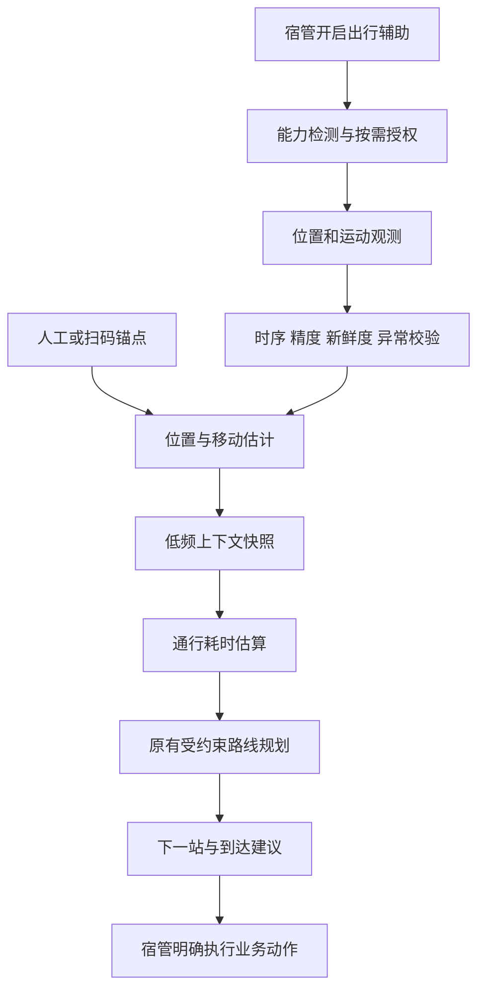

# 鸿蒙设备能力需求与方案

日期：2026-11-11。状态：需求与方案设计，未接入设备采集、未新增权限、未修改OpenAPI。用户已确认本轮先扫描和设计。当前实现基线与重构任务见[11](11-全项目扫描与后端重构设计.md)，术语见[CONTEXT](../CONTEXT.md)。

## 1. 产品方向

设备数据用于减少手工定位、改善到达预估和现场记录。先让宿管明确开启“本次出行辅助”，系统展示位置来源、精度、新鲜度和估算依据；到达、接单和完工仍由有权限的人明确操作。学生端优先使用按需拍照、扫码核对和提醒，不建立连续学生轨迹。

当前只有互联网权限，位置来自手选／办理记录，通行表只有分钟数。没有校园实测路径长度、楼栋边界、二维码布设或真机速度准确率。因此“读到GPS”不代表已经定位到楼层和房间，“有速度值”也不等于能够可靠计算上门时间。

## 2. 新增功能清单

| 编号 | 使用者与能力 | 交互及业务规则 | 阶段 |
| --- | --- | --- | --- |
| DEV-M01 | 宿管本次出行辅助 | 主动开始、暂停、结束；明确采集用途及状态。退出、换号或会话撤销停止采集；拒绝权限仍可手工定位与办理 | 首期 |
| DEV-M02 | 自动位置候选 | 可靠室外观测提示楼栋／入口；显示精度和更新时间。楼层保留最近人工／扫码锚点，不反推房间 | 首期 |
| DEV-M03 | 移动状态与速度估计 | 融合系统速度、可信位移与计步摘要；返回静止／步行／未知、估计值或空值、质量和来源，不输出虚假精确数值 | 首期 |
| DEV-M04 | 锚点校正 | 扫码或人工选择已登记的楼栋入口／楼层，先展示再确认；只使用有权限的地点。二维码不是身份、到场或考勤证明 | 首期，可先人工 |
| DEV-M05 | 到达建议与路线说明 | 接近当前目标时提示“可能已到达，请确认”；提示一次并允许忽略。设备事件不能自动接单、到达、完工或转移责任 | 首期 |
| DEV-M06 | 系统直接拍照 | 报修办理、巡检直接打开系统拍摄界面；取消保留草稿，沿用压缩、去EXIF、私有上传和失败重试 | 首期 |
| DEV-M07 | 熄屏／后台持续出行 | 显式持续任务、位置授权、常驻提示和停止入口；把有效工作会话活跃与前台登录心跳分开设计 | 第二阶段，实际移动值班需要 |
| DEV-M08 | 通行耗时校准 | 可信锚点间片段积累足够样本后更新共享通行估算，分开移动、停留、维修和沟通时间 | 第二阶段 |
| DEV-S01 | 学生系统拍照报修 | 选图与直接拍摄并存；房间继续来自当前入住，不因定位或二维码改成他人房间 | 首期 |
| DEV-S02 | 扫码核对宿舍／设施 | 扫码后向服务端查询并核对本人房间；不匹配时说明原因，不能直接扩大报修权限 | 首期可选 |
| DEV-S03 | 预约提醒与到访预告 | 已确认预约可主动添加系统日历／本地提醒；通知展示概括内容，点击后鉴权查看 | 第二阶段 |
| DEV-S04 | 便捷现场输入 | 优先复用系统输入法语音输入、系统分享／拨号界面；由用户明确触发，不后台录音、不自动拨号 | 可选 |
| DEV-P01 | 公共区域设施报修 | 必须另定地点类型、设施归属、学生资格、派单范围与审计，不能通过扫码／GPS隐含突破“本人宿舍报修” | 需求扩展后再实施 |
| DEV-P02 | 气压、蓝牙／NFC室内辅助 | 气压仅作趋势实验；蓝牙信标／NFC需要硬件、点位维护及额外权限。手机不能默认测量室温、湿度或卫生合格程度 | 后续实验 |

首期前台采集是功能与质量试点，不能作为“手机放入口袋熄屏后仍持续定位”的交付。若目标是完整移动值班体验，第二阶段后台持续出行是必要工作。

## 3. API24 系统能力核实

| 能力 | 使用方式与版本边界 | 权限／降级 |
| --- | --- | --- |
| 定位 | `LocationKit.geoLocationManager.on('locationChange', ContinuousLocationRequest, callback)`；使用API24可用重载，不复制最新API26的 `onLocationChange` | 按动作申请近似／精确定位，精确定位与近似权限配合；被拒绝或服务关闭时手工锚点可用 |
| 运动／计步 | `SensorServiceKit.sensor` 查询支持情况，再成对订阅／取消 PEDOMETER；加速度只帮助判断静止／移动 | 计步涉及 ACTIVITY_MOTION；加速度按SDK要求声明权限。无硬件则使用其他来源或未知状态 |
| 扫码 | ScanKit 系统默认 `startScanForResult`，本机SDK具备API11／12入口 | 系统默认界面与自管相机扫码分开核对；不照搬自定义扫码的CAMERA要求 |
| 拍照 | CameraKit `cameraPicker.pick`，API11起 | 优先系统选择式拍摄流程，不为此直接申请广泛相机／图库访问；仅处理返回资源 |
| 日历 | CalendarKit `editEvent`，API12起，交给系统创建页 | 不读取全量私人日历；直接读写日历是另一种权限更广的方案 |
| 通知 | NotificationKit检查和请求通知许可；已知预约可发本地提醒 | 本地通知不能在应用被终止时凭空接收新工单。可靠服务端推送另需PushKit／注册与服务端方案 |
| 网络／电量 | NetworkKit网络变化、BasicServicesKit电量信息 | 仅用于退避和省电；网络已连接不等于API可达 |
| 持续后台 | BackgroundTasksKit LOCATION持续任务，配置后台模式、可见通知与停止控制 | 按所选API24模式处理 KEEP_BACKGROUND_RUNNING、位置及必要后台位置授权；仍受系统资源与省电限制 |

以上由本机API24 SDK声明与[官方定位资料](https://developer.huawei.com/consumer/en/doc/harmonyos-references/js-apis-geolocationmanager/)、[传感器资料](https://developer.huawei.com/consumer/en/doc/harmonyos-references/js-apis-sensor/)、[后台任务](https://developer.huawei.com/consumer/en/doc/harmonyos-references/js-apis-resourceschedule-backgroundtaskmanager/)、[系统扫码](https://developer.huawei.com/consumer/en/doc/harmonyos-references/scan-scanbarcode-api/)、[CameraPicker](https://developer.huawei.com/consumer/en/doc/harmonyos-guides-V5/camera-picker-V5/)、[日历创建流程](https://developer.huawei.com/consumer/en/doc/harmonyos-guides/calendarmanager-event-developer/)交叉核对。精确SDK文件、行号和支持条件保存在[能力报告](../output/analysis/harmony-device-capabilities.json)。能力声明不代替真机硬件、权限和后台行为测试。

## 4. 采集、估计和业务事实分开

四类状态不能合并：账号是否活跃、是否愿意接受新任务、设备观测是否新鲜、工单是否正在执行。位置权限被拒绝不会取消宿管资格，位置上报也不能偷偷恢复“接受新任务”。

当前前台心跳在后台停止、120秒判离线。第二阶段需要允许**有效且显式开启的持续工作会话**提供活跃证据，同时检查账号、会话、租约和采集状态；不能只接收后台GPS，却仍把正常出行宿管判离线，也不能用任意迟到样本维持在线。

## 5. 位置与移动速度规则

### 数据单位和可信程度

系统Location使用WGS84，`accuracy`为米，`speed`为米／秒，`speedAccuracy`在支持时参与质量判断；UTC `timeStamp`为毫秒，`timeSinceBoot`为纳秒。传输协议统一为明确命名的单位，单调时钟可先转为毫秒；不能混用秒、毫秒和纳秒。接口不传IMEI、MAC或全局设备标识，使用会话范围的随机设备实例标识。

每个估计包含来源、观测时间、接收时间、有效期、质量等级和不可用原因。质量等级首先是规则评分，不宣传成经过统计校准的概率。过期位置不能展示成“实时”；没有有效数据时返回未知／最后确认锚点，而不是默认0速度或默认已到目标。

### 速度来源顺序

1. 优先使用精度与速度精度可接受的系统速度，过滤明显异常、过期和不连续观测。
2. 相邻有效位置有合理时间差，且位移显著大于两次定位误差时，才使用球面距离／单调时间差；静止GPS漂移不形成走动速度。
3. 计步差分／步频与经校准的步长可提供低质量辅助值，不能将默认步长当作个人真实值；未知时保持空值。
4. 加速度／线性加速度用于运动状态与异常提示，首期不使用双重积分推算可靠速度和轨迹。

计步器是开机累计值且可能延迟；暂停、换号、进程重启、计数回退或长间隔后重置片段基线，不把非工作步数、上次会话或新开机数据拼接进来。墙钟用于记录时间，片段耗时优先用同一启动周期的单调时钟。时间倒退、未来点或断流不能产生负速度。

每个采集进程使用临时片段标识；重启后强制新来源代际，不能在旧代际下继续对单调时钟或累计步数做差。不需要持久硬件标识来实现分段。

首期按步行建模；持续高速、车辆移动或来源不明时标为不适用于步行模型，交回通行基线。未知状态与静止是不同结果，不强迫所有观测都有数值。

### 室内校正

楼栋候选需要已登记边界／入口坐标、统一坐标系、精度门槛及进入／离开滞回。未配置校园地理数据时只展示观测质量和人工位置，不虚构楼栋坐标。相邻楼栋重叠或精度不足时请用户确认。

楼层以人工／扫码确认锚点为主；GPS高度与气压不能直接证明房间号。气压仅在硬件存在、有基准且通过试点后辅助楼层变化，不覆盖人工确认事实。

锚点绑定楼栋、确认时间及有效条件。可靠离栋、换楼或长时间断流后，旧锚点只作历史展示，当前楼层降为未知并使用明确的保守通行回退；不能把A栋3层拼接成B栋3层。人工确认位置和自动候选分别保留，避免自动观测覆盖了用户刚确认的事实。

二维码只解析项目自有锚点格式，先展示地点和来源，再通过服务端查授权与有效状态；陌生URL、未登记锚点或其他楼栋不自动打开／写位置。静态二维码可被复制，不能用作身份、考勤或可靠物理到场证明。

## 6. 速度如何帮助调度

当前 `dispatch_travel` 保存的是分钟数，不是米数。不能把“楼栋间5分钟”当作5米，也不能仅因获得速度就对原分钟数直接除法。

- 尚无路径长度时，继续使用原人工通行基线；以可靠锚点间的实际移动片段逐步校准耗时。
- 配置并核验路径长度、出入口与坐标后，才对室外步行段使用距离／速度估算。楼梯、电梯与等候分别处理，不能统一套用水平步行速度。
- 当前出行速度可以辅助当前片段ETA；数据不足时退回共享模型，不自动降低该宿管接单资格。
- 通行片段以出发／到达确认及锚点界定，剔除维修、配件等待和长时间沟通；误触、暂停和异常片段不进入学习。
- 静止不等于维修：电梯排队、等红灯等正常通行等待应计入相应通行成本。无法可靠区分的片段降低质量或不用于学习，不能自动扣掉所有停止时间以制造乐观ETA。
- 初期优先共享楼栋／出入口片段的稳健统计，积累样本后再评估个人化模型；速度数据不进入绩效排名或处罚规则。
- 客户端速度和质量只是证据；登录和租约证明发布账号，不证明真实物理位置。服务端重新校验时序、范围、精度、异常速度及锚点授权，并限制可采用的质量等级；单个来源的自报高质量摘要不能直接更新共享模型。学习需有效样本与独立会话门槛、异常隔离、模型版本和回退机制，具体阈值由试点冻结，不宣称已经实现防伪定位。
- 路线算法只接收有质量标记的通行成本快照，不订阅传感器，也不等待移动网络或AI请求。

候选初始参数：移动时5～10秒一次定位请求，10～15秒上报一个摘要批次；静止时降低频率，低电量进一步退避；最新观测约60秒后降级，长断流后失效。明显ETA变化可从“偏移至少60秒且持续两个有效窗口”开始试点。**这些是设计参数，未实测，不是准确率、电量或刷新时效承诺。** 紧急工单与明确执行动作不受普通位置抖动的去抖延迟影响。

## 7. 模块、接口和数据草案

### 鸿蒙模块

新增独立 `features/mobility`：工作会话控制、系统能力适配、质量过滤、移动估计、低频发送各管职责。复用 `AppVisibility` 和调度会话代际机制；权限弹窗、传感器监听、定时器不继续塞进 `Index.ets`。

订阅必须成对停止；注销、换号、销毁、权限撤销与异常都覆盖。发送与回调都检查当前账号及来源代际；过期回调不得覆盖新账号，也不得继续传输旧坐标。原生纯计算可用回放适配器测试，真实位置、权限和后台服务通过官方Kit与真机验证。

### 后端接口草案

以下路径与字段仅为设计，不是已经存在的API；实施前先修改 `contracts/generate_openapi.py`，再生成OpenAPI和客户端模型。

| 草案操作 | 核心数据／约束 |
| --- | --- |
| `POST /mobility/sessions` | 开启当前宿管工作会话，服务端派生人员身份，返回来源租约、上报策略和版本 |
| `GET /mobility/session` | 查询本账号会话、采集状态和当前来源，供换端与恢复使用 |
| `POST /mobility/sessions/{id}/samples` | 小批摘要；批次ID、序号、来源代际、观测时间、单调耗时、位置／精度、速度／质量和计步差分；限制条数、字节和频率 |
| `POST /mobility/sessions/{id}/pause`／`resume`／`end` | 显式状态转换、版本检查；退出或撤销会话仍须在服务端自动失效 |
| `POST /mobility/sessions/{id}/anchor-confirmations` | 已登记锚点、用户确认与预期版本；核对地点授权，不接受任意房号 |
| `GET /dispatch/board` 的可选扩展 | 位置来源／新鲜度、估算依据和有限质量字段；精细坐标默认仅本人，其他人按负责范围看粗粒度工作位置 |

新接口不能使用请求中的managerId决定身份；同批次同正文重放返回同一ACK，改正文拒绝；乱序和旧来源不回退当前位置。上报路径不复用现有按用户串行化的通用业务锁，不逐个采样写业务审计或触发计划。设备数据版本独立于接单设置版本，避免高频采集导致用户保存表单不断409。

首期候选上限为每批20条摘要、16KB正文；原始加速度数组不在协议内。批次收件与短ACK可复用既有幂等存储的受限记录，但采用独立短事务、工作会话序号和有界清理，不能调用当前通用命令的用户锁／清理路径。ACK保留期至少覆盖允许重试窗口；超过窗口的旧批次拒绝，不能在清理后重新当新位置。最终收件存储与保留参数需在物理设计时冻结。

### 最小持久化草案

| 数据 | 用途与边界 |
| --- | --- |
| `field_work_session` | 当前工作会话、账号及服务端派生的authSessionId、来源代际／租约到期、状态、开始结束和授权用途版本；每批检查登录会话仍有效，不把设备实例数量当宿管人数 |
| `manager_context_snapshot` | 每账号最新位置／锚点、移动状态、估计速度、质量、有效期与独立版本；覆盖最新值，默认不存连续轨迹 |
| `campus_anchor` | 楼栋入口／楼层点位、坐标系及有效状态；没有布设时保留人工入口 |
| `travel_leg_summary` | 有效片段起终锚点、耗时、质量与采用依据；不保存原始传感器数组 |

这四项是逻辑数据需求，最终物理表和字段待实施时与现有表复核合并。后续独立增量迁移，不能改写已应用V2，也不为普通地点和楼层引入空间数据库插件。

同一账号多设备登录仍只计一人，但位置发布需要唯一有效来源租约。新设备接管要显式确认，旧设备回调立即失效；不能把两台手机的位置拼成高速移动。学生没有宿管位置发布接口。

## 8. 数据最小化与失败降级

原始加速度留在本机短窗口计算，不逐事件上传；默认只上传工作所需摘要和最新位置。位置采集与AI分析分别授权，AI默认不获得坐标或轨迹。照片继续去EXIF；确需地点说明时保存用户确认的业务地点及来源，不偷偷保留照片GPS。

候选保留策略：本机原始窗口不超过2分钟；断网不持久保存精细轨迹，有限保存无坐标片段摘要；服务端精细最新位置随工作会话结束／过期按策略清理，片段摘要可先采用30天保留再聚合。具体策略需实施前定稿并落实清理、备份和展示规则，不能把逻辑过期承诺成所有备份中即时不可恢复。

| 异常 | 必须发生的行为 |
| --- | --- |
| 用户拒绝精确／运动权限、系统服务关闭 | 告知本项不可用；其他功能和手工定位继续 |
| 无计步／气压／后置相机等硬件 | 识别能力缺失并降级，不把0当正常观测 |
| GPS漂移、楼栋边缘来回跳 | 精度与滞回过滤，不反复改楼栋或生成计划 |
| 乱序、时间跳变、开机累计回退 | 拒绝旧点／重置片段，当前位置不回退 |
| 离线重连 | 有界退避与批次幂等；旧观测不能成为当前实时位置 |
| 换号、双设备接管、权限撤回 | 失效旧代际、停止监听和发送，服务端拒绝旧租约 |
| 离开前台但未获后台能力 | 明确暂停，停止宣称实时；后台阶段使用持续任务另验 |
| 偏离目标／接近目标 | 仅建议核对地点；责任、出发、到达和完工仍走原受控动作 |

## 9. 验收与实施输入

计算回放至少覆盖静止噪声、正常步行、速度异常、误差大于位移、乱序、时钟倒退、重启计数回退和双设备切换；断言未知值、质量、来源和降级，不只断言算出一个速度数字。

后端验证身份派生、楼栋范围、租约接管、批次重复／冲突、频率与体积上限、旧样本拒绝，以及高频上报不阻塞认领／设置。规划回归继续覆盖冻结前缀、硬预约、归属和无解原因。

API24模拟器验证流程、回放和异常入口；真实手机用于验证室外／室内精度、计步硬件、口袋／持机差异、熄屏、省电、后台终止、网络切换、电量和内存。模拟器注入成功不能冒充真实定位准确率。

实施前需要：可调试HarmonyOS真机、已核验的校园楼栋／入口数据、可维护的二维码点位（可后置）、后台应用能力与通知／推送条件。未提供地图和硬件时仍可完成接口与回放，但不能承诺室内房间级定位或真实行程节省百分比。
